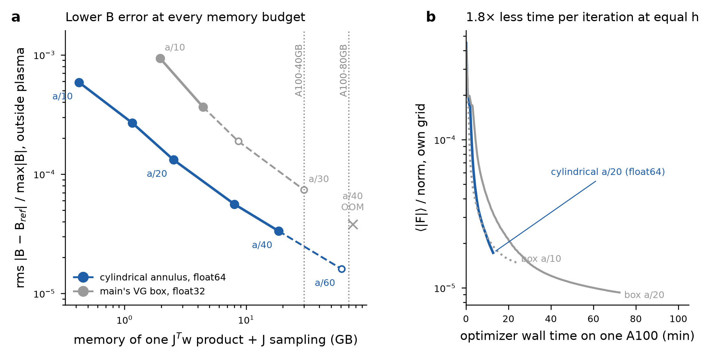

# Cylindrical-annulus J → B solver (branch `cylindrical-grid`)

Status 2026-10-17 (evening). Stages A–C done locally; B5 done; stage D D1–D2 run on Modal A100s (results and a correction below: **the cylindrical path must run in float64**, now the default).
Plan and check-list: `docs/cylindrical_grid_plan.md`. Stage reports: `docs/cylindrical_grid_stageA.md`, `docs/cylindrical_grid_B4.md`.

## What it is

B_plasma = curl A with ΔA = −μ0 J in free space, solved on one field period of an annulus R_in ≤ r ≤ R_out, |z| ≤ z0 around the plasma (walls 2h outside it):
Fourier in φ (N_φ odd planes per period), Chebyshev in r and z, a Dirichlet solve per toroidal mode by matrix diagonalization, and James' correction u = u_D + S_m[σ] with the toroidal single-layer matrices S_m.
A_z takes the modes j·NFP and A₊ = e^{iφ}(A_r + iA_φ) the modes j·NFP + 1, so both are NFP-periodic scalars.
J reaches the nodes through main's flux-grid `PointInterpolator`; B goes to the collocation points by barycentric (r, z) and exact Fourier (φ) interpolation.

Use: `optimize_qa.py --grid cylindrical` (same `--frac`, `--margin`, check options), or `Fields(force, current, pressure)` with a `CylindricalGrid` box.
Options: `cyl_dtype` (precision of the cylindrical path; **float64 default**, `optimize_qa --cyl-dtype`; float32 is not accurate at production sizes, see "Stage D"), `dtype` (main's box only, float32 default), `S_dtype` (float32 storage of S_m), `cyl_half` (stellarator-symmetric half sampling, default on), `FreeSpaceAnnulus(zsym="auto")` (z-folded S_m).
`DenseFields` works unchanged. Main's paths are bitwise unchanged (C4).

## Gates (all pass)

| Gate | Result |
|---|---|
| A1–A5 | Chebyshev operators; κ(V_r) ≤ 4 for \|m\| ≤ 738; Q_{m−½} vs mpmath 5e-11 at m = 1000; S_m vs a 3-D integral 4.3e-15 |
| A5b | z-folded S_m vs dense 2e-15, storage exactly ½ |
| A6 | scalar free-space solve vs Gaussian charges 1.1e-12 (n = 96, N_φ = 251) |
| B1–B3 | JAX vs NumPy 1e-15; manufactured field 1.8e-12; div B 1e-15; adjoint 4e-15; `check_grads` |
| B4 | NEST's J on precise_QA: at equal h, 0.7–0.8× the box's interior error and ~0.6× its exterior error, with ~7× fewer points |
| C1, C1b | inside-node volume 1.8e-3, section current 3.1e-3 (a/6); symmetric locate identical in half the time |
| C2, C2b, C2c | `Fields` vs standalone 1e-14; half sampling 7e-15; float32 vs float64 B 1.6e-6 rms |
| C3 | Jv vs `jax.jvp` 5e-16; adjoint 2e-15; optimizer's `linear_transpose` JᵀW vs vjp 1.5e-16 |
| C4 | 17/17 arrays bitwise identical to 263bfad |
| C5 | 20 iterations at a/6 (factors 1): see below |
| C6 | dense G vs solve 4e-14; u0ᵀG cylindrical vs box 1.0e-2 at a/6 (box error dominates: 1.0e-2 vs 4.2e-3 against a cylindrical a/10 G) |

C5 (precise_QA smooth J, a/6, factors 1, 20 iterations, cg 100; check on the VG box at a/10 with 3× collocation):

| backend | ⟨\|F\|⟩/norm own grid | check | s/iteration (median of last 10) |
|---|---|---|---|
| cylindrical | 4.27e-4 → 1.28e-4 | 1.31e-4 | 39 |
| VG box | 4.28e-4 → 1.31e-4 | 1.41e-4 | 141 |

## B5: memory and time

Measures: the J → B_plasma pipeline of one optimizer product (J at the sampled nodes → B at main's production collocation, 1.65M points), forward and JᵀW (`jax.linear_transpose`).
Model: XLA's compiled memory analysis, args + output + temporaries (`tests/cyl_memory.py`); not included are the h-independent collocation-side caches shared by both methods (~4.5 GB at production on the GPU).
"Optimised" cylindrical = float32 arithmetic, stellarator-symmetric half sampling, z-folded S_m (S_m in parentheses, already inside the JᵀW figure).
**Superseded:** the float32 column is not usable in production (Stage D); the float64 figures in "Stage D" replace it for the memory comparison.

| h | cylindrical, optimised: JᵀW + sampling (S_m) | cylindrical, float64 unfolded | main's box, float32 | box / cyl optimised |
|---|---|---|---|---|
| a/10 | 0.23 + 0.04 = **0.27 GB** (0.05) | 0.55 GB | 1.96 GB | 7.2× |
| a/15 | 0.58 + 0.14 = **0.72 GB** (0.15) | 1.55 GB | 4.41 GB | 6.1× |
| a/20 | 1.23 + 0.32 = **1.55 GB** (0.33) | 3.40 GB | 8.62 GB | 5.6× |
| a/30 | 3.85 + 1.03 = **4.88 GB** (1.08) | 10.82 GB | 29.92 GB | 6.1× |
| a/40 | 8.86 + 2.39 = **11.25 GB** (2.51) | 25.05 GB | 75.37 GB | 6.7× |
| a/60 | 29.09 + 7.90 = **36.99 GB** (8.29) | 82.50 GB | int32 overflow | — |
| a/80 | 68.32 + 18.55 = **86.87 GB** (19.45) | — | int32 overflow | — |

Measured (`tests/cyl_measure.py`, laptop CPU, process peak RSS including ~0.3 GB JAX runtime, synthetic J of production size):

| run | grid | nodes | J rows | build peak | fwd peak | JᵀW peak | fwd | JᵀW |
|---|---|---|---|---|---|---|---|---|
| cylindrical a/10 (float32, sym, z-fold) | 251x71x82 | 1.5M | 58,452 | 0.70 GB | 0.82 GB | 0.88 GB | 0.51 s | 0.44 s |
| cylindrical a/15 (float32, sym, z-fold) | 373x103x119 | 4.6M | 182,874 | 0.84 GB | 1.03 GB | 1.24 GB | 1.05 s | 1.01 s |
| cylindrical a/15 (float64, full, unfolded) | 373x103x119 | 4.6M | 365,748 | 0.72 GB | 1.28 GB | 1.46 GB | 1.88 s | 1.92 s |
| cylindrical a/20 (float32, sym, z-fold) | 495x134x156 | 10.3M | 413,899 | 1.38 GB | 1.59 GB | 1.78 GB | 1.57 s | 1.62 s |
| cylindrical a/25 (float32, sym, z-fold) | 615x166x193 | 19.7M | 788,134 | 1.38 GB | 2.07 GB | 2.19 GB | 2.91 s | 3.49 s |
| box a/10 (float32) | 315x315x99 | 9.8M | 61,395 | 1.53 GB | 2.19 GB | 2.19 GB | 3.89 s | 5.86 s |

The model matches the box (2.19 GB measured vs 1.91 + 0.3) and the cylindrical a/20 (1.78 vs 1.23 + 0.3 + build transient); at a/10–a/15 the cylindrical peak is set by the build transients, not the pipeline.
Not done locally: the per-stage breakdown (gather, FFT, mode solves, S matvec, curl, interpolation) that the plan asks for; it goes into D1 on the GPU, where `cyl_measure.py` records the device peak.

What changed in B5: float32 path (C2c), symmetric half sampling (C2b), z-folded S_m (A5b), symmetric locate (C1b), and the S_m build batched over targets (3–4× faster, bitwise identical).
Banded S_m was measured and dropped: in the nodal basis about a third of the entries of S_m stay above 1e-10 even at high \|m\| (each face's global Lagrange interpolation spreads the local kernel), so banding saves at most ~3× with ragged storage.

(a) Exterior B error (rms over 177 converged points 0.15–0.41 a outside the plasma, `results/cyl/b4/exterior_fine.json`) against the pipeline memory of the JᵀW product plus J sampling (model). Filled: measured errors; open/dashed: O(h^p) extrapolation with the fitted orders (cylindrical p = 2.16 from a/10–a/20, box p = 1.71 from a/10–a/15). Dotted: A100 budgets less ~4.5 GB shared. (b) Measured laptop CPU time per JᵀW.

## Stage D: GPU results (Modal A100, 2026-10-17; scripts in `scripts/modal_cyl/`)

**J → B pipeline on the GPU** (`tests/cyl_measure.py`, A100-80GB, device peak of the pipeline alone; the cylindrical rows are the float32 path, float64 costs ~1.5–2× more):

| h | main's box (float32): JᵀW / peak | cylindrical (float32 path): JᵀW / peak |
|---|---|---|
| a/20 | 0.26 s / 5.5 GB | 0.07 s / 1.26 GB |
| a/30 | 0.97 s / 21.4 GB | 0.18 s / 3.77 GB |
| a/40 | out of memory on 80 GB (the kernel build alone reached 43 GB) | 0.33 s / 7.9 GB |

**Exterior B error, cylindrical, to a/40** (`tests/cyl_b4.py cyl` on the GPU; rms over the 171 converged reference points that lie inside every annulus, `results/cyl/b4/exterior_d1.json`):

| a/10 | a/15 | a/20 | a/30 | a/40 |
|---|---|---|---|---|
| 5.88e-04 | 2.68e-04 | 1.32e-04 | 5.60e-05 | 3.33e-05 |

Local order 2.1 (a/20–a/30) and 1.8 (a/30–a/40, near the reference's own accuracy). The box on the same points: 9.36e-4 (a/10), 3.67e-4 (a/15). Targets outside an annulus cannot be evaluated by interpolation (six or seven of the 200 at a/30–a/40).

**Production optimizations** (precise_QA smooth J, factors 3 3 2.5, 133,908 unknowns, collocation 65 × 257 × 99, cold start, defaults: free pressure, W 10, p ≥ 0; A100-40GB):

| run | iterations | s / iteration | ⟨\|F\|⟩/norm own grid (it 10 / 20 / 30 / end) | check (3× collocation) | GPU peak (nvidia-smi) |
|---|---|---|---|---|---|
| cylindrical a/20, float32 (D2a) | 17 | 14.7 | 1.23e-04 / — / — / 1.16e-04 | 8.55e-05 on VG box a/20 | 19.9 GB |
| cylindrical a/30, float32 (D2b) | 14 | 30.6 | 1.61e-04 / — / — / 1.63e-04 | 2.02e-04 on cylindrical a/40 (float32, invalid) | 17.8 GB |
| cylindrical a/20, float64 | 30 | 23.6 | 4.79e-05 / 2.43e-05 / 1.72e-05 / 1.72e-05 | 1.83e-05 on VG box a/20 | 20.5 GB |
| box a/10 (control) | 100 | 14.1 | 5.66e-05 / 3.61e-05 / 2.76e-05 / 1.48e-05 | 2.11e-05 on VG box a/20 | 19.7 GB |
| box a/20 (control) | 100 | 43.2 | 5.39e-05 / 2.79e-05 / 1.93e-05 / 9.31e-06 | 9.35e-06 on VG box a/20 | 21.1 GB |

**Float32 correction.** Both float32 cylindrical runs stalled: line-search steps ~0.6, the objective rising, stopped by the stagnation rule after 14–17 iterations. The same a/20 run in float64 steps ~1.0 and tracks (slightly ahead of) the box at equal h. The float32 B error grows ~n² with the Chebyshev order (rms against float64 over the modes: 4.4e-5 at a/6, 8.6e-5 at a/10, 1.7e-4 at a/15, 3.5e-4 at a/20; `results/cyl/c6/f32_vs_h.log`). It comes mostly from the per-mode Dirichlet solve (float64 there: 1.0e-4 at a/20) and from differentiating an A rounded to float32 (whole per-mode solve in float64: 7.7e-5); differentiation in float64 alone does not help (`f32_mixed.log`). The a/6 gates (C2c, 1.6e-6 in the plasma) did not reveal it. The cylindrical path is now float64 by default (`cyl_dtype`, commit f2d00f8).

**Memory with float64** (XLA model, `results/cyl/memory_f64opt.json`; JᵀW product + J sampling, sym half sampling, z-folded S_m in float32):

| h | cylindrical float64 (sym, z-fold) | main's box float32 | box ÷ cylindrical |
|---|---|---|---|
| a/10 | 0.42 GB | 1.96 GB | 4.6× |
| a/15 | 1.16 GB | 4.41 GB | 3.8× |
| a/20 | 2.53 GB | 8.62 GB | 3.4× |
| a/30 | 8.01 GB | 29.92 GB | 3.7× |
| a/40 | 18.51 GB | 75.37 GB | 4.1× |
| a/60 | 60.88 GB | int32 overflow | — |

At a/20 the production runs all peak at ~20–21 GB: the h-independent parts (collocation side, block preconditioner, the 3× check) dominate there, and the J → B difference shows in the totals only at finer h.

**Lesson for GPU jobs.** The S_m build is NumPy on the host CPU (~4× slower per core on Modal than on the laptop; a/30 ~8 min, a/40 ~20–30 min) and left the GPU idle for most of the ladders. Build S_m (and locate, fits) once on a CPU container, cache it on the Volume keyed by grid, and start GPU jobs after.

## Verdict (revised after stage D)

The cylindrical grid is validated as more accurate and more economical than main's box, by less than the overnight float32 estimate:
1. Accuracy per h: exterior B error ~0.6× the box's, converging ~O(h²) to a/40 (3.3e-5).
2. Memory at equal h (float64): 3.4–4.6× less for the J → B product than the float32 box (overnight float32 claim: 5.6–7.2×). On one A100, estimated finest h: about a/60–65 on 80 GB and a/45–48 on 40 GB, against about a/35 and a/30 for the box (the box measured: a/30 21.4 GB, a/40 out of memory). These cylindrical limits are model-based; a float64 GPU ladder has not been measured.
3. Time: 1.8× less per optimizer iteration than the box at equal h (a/20: 23.6 vs 43.2 s), converging slightly faster per iteration.

## Open items

Validation: a float64 GPU memory ladder; a converged (100-iteration) cylindrical run checked on a finer float64 cylindrical grid; an h-ladder at fixed basis (where refining h stops lowering the checked force); NCSX and W7-X (larger predicted gains); the axisymmetric N_φ = 1 path (D3, DSHAPE); combination with the container-mask free boundary.
Optimizations: S_m build speed and caching; Chebyshev wall clustering (~2.5× nodes in (r, z); mapped nodes or a z sine transform); mode truncation (if J's φ-spectrum allows); on-the-fly J-sampling weights; low-rank S_m blocks; solve symmetry; mixed precision (limited: 7.7e-5 at a/20).

## Notes for main

- `convergence_b_plasma.py`'s exterior reference compares the continuous Biot–Savart at a basis resolution with one at 2/3 of it; for precise_QA's (48, 48, 35) the 2/3 level under-resolves N = 35 and gives a 1.1e-2 self-difference. Use (64, 64, 56) vs (48, 48, 42).
- The J-sampling cache (`PointInterpolator`: 64 indices and weights per point) is a large part of both methods' memory at fine h (cylindrical a/40: 2.4 GB of 11 GB); computing the weights on the fly would remove it for both.

## Files

`nest/`: chebyshev.py, annulus_poisson.py, toroidal_kernel.py, single_layer.py, annulus_freespace.py (FreeSpaceAnnulus, ZFold), cylindrical_bs.py (CylindricalSolver), cylindrical_grid.py (CylindricalGrid, CylindricalInterpolator); objective.py, force.py, dense.py (cylindrical branches).
`tests/`: test_cylindrical_bs.py (A1–B3), test_cylindrical_integration.py (C1–C6), cyl_a6.py, cyl_manufactured.py, cyl_b4.py, cyl_g0_probe.py, cyl_memory.py, cyl_measure.py.
Results (gitignored): `results/cyl/` (a6.json, b4/, c5/, c6/, memory.json, memory_opt.json, measure/).
