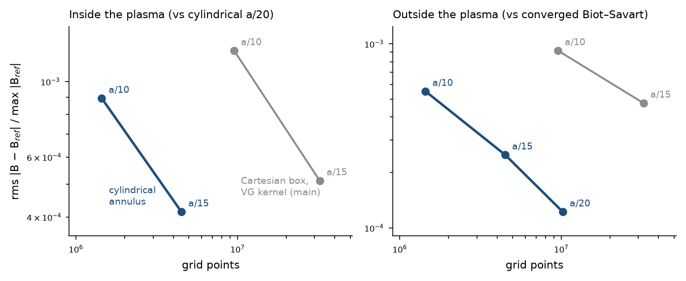

# Cylindrical-annulus J → B, stage B report (stop point S2)

Branch `cylindrical-grid`. Gates B1–B3 are in `tests/test_cylindrical_bs.py`. B4 is `tests/checks/cyl_b4.py` (steps `targets`, `ref`, `cyl`, `box`, `analyze`), with results in `results/cyl/b4/` (`analysis.json`, `exterior_fine.json`, one json per run).

## B1–B3 (exact tests)

| Gate | Result |
|---|---|
| B1 JAX apply path against the NumPy reference | 8.8e-16 (A_z), 9.4e-16 (A₊), NFP 3, chunked mode loop |
| B2 manufactured exact field (A = curl ψ, J = −ΔA/μ0, B exact inside and out) | 3.9e-2 (n = 40) → 1.8e-12 (n = 104, N_φ = 91): spectral |
| B3 identities | div B 1e-15; curl B − μ0J 7e-10; B(J + ∇χ) − B(J) 2.5e-14 with \|∇χ\| = 0.3 max\|J\|, and curl B − μ0J′ = −μ0∇χ to 7e-10; adjoint 4e-15; `check_grads` (fwd, rev) passes |

## B4 setup

- **J:** NEST's `BoundaryPotential` at the production factors (3, 3, 2.5), with 90,408 free unknowns and edge power 2, so J ~ (1 − ρ) and has a kink on ρ = 1.
- **Equilibrium (deviation from the plan):** smooth-current precise_QA (`precise_QA_free_boundary_smooth_J_edgeJ_r0.3.h5`) instead of L16N14. It is main's own B-convergence case, so main's earlier box errors can be compared directly. It has the same edge window and geometry.
- **Interior targets:** the force collocation grid at ForceResidual's default resolution, 17 × 65 × 57 = 62,985 points over a full period.
- **Exterior targets:** 200 points 0.15–0.40 a outside the LCFS, inside the a/20 annulus.
- **J at the nodes:** exact on both sides (the series at the Newton-mapped flux coordinates), as in main's `convergence_b_plasma.py`. The box is float64 with the VG truncated kernel and a type-2 NUFFT (eps 1e-12) to the points.
- **Cylindrical method:** margin 2 h and S_m stored in float32 (it changes B by ≤ 8e-9).

## Results

Rms of |B − B_ref| / max|B_ref|, volume-weighted inside:

| Run | Grid points | Interior (vs cylindrical a/20) | Interior max (ρ 0.95–1) | Exterior (vs converged Biot–Savart, 153 points) | Solve (CPU) |
|---|---|---|---|---|---|
| box a/10 | 9.53M | 1.23e-3 | 9.0e-3 | 9.2e-4 | 0.8 s |
| box a/15 | 32.3M | 5.1e-4 | 6.6e-3 | 4.8e-4 | 2.0 s |
| cylindrical a/10 | 1.44M | 8.9e-4 | 1.0e-2 | 5.5e-4 | 0.1 s |
| cylindrical a/15 | 4.50M | 4.1e-4 | 7.3e-3 | 2.5e-4 | 0.5 s |
| cylindrical a/20 | 10.2M | (reference) | — | 1.2e-4 | 1.5 s |

1. **Equal h, comparable or better accuracy.**
   - Inside the plasma, the cylindrical error is about 0.7–0.8× the box's.
   - Outside, it is about 0.5×, and converges at about O(h²): 5.5e-4 → 2.5e-4 → 1.2e-4.
   - Inside, both are limited by the kink at ρ = 1. All maximum errors (≈ 1%) sit in ρ 0.95–1.
2. **About 7× fewer points at equal h** (4.5M against 32.3M at a/15). Cylindrical a/10, with 22× fewer points, matches box a/15 outside the plasma (5.5e-4 against 4.8e-4).
3. **The references agree with each other.** The box's distance from cylindrical a/20 (1.23e-3 and 5.1e-4) is close to its error measured earlier on main against VG a/30 (1.4e-3 and 5.2e-4; within 14% and 2%).
4. **Interior convergence is irregular.** a/10 → a/15 → a/20 does not follow a clean power law, as is typical for a kink on a non-aligned grid. The cylindrical a/20 interior error is bracketed between 1.5e-4 and 5.3e-4 by an O(h²) argument; point 3 favours the low end.

## Checks

- **(d) Main's cached Lagrange J in place of exact J** (cylindrical a/10): 1.1e-4 rms difference, 2.8e-3 max at the edge. That is well below the a/10 discretization error, so the bias shared with the box through J interpolation is small.
- **Margin δ = 1, 2, 4 h** (a/10): the error against a/20 is 8.9e-4, 8.9e-4 and 9.8e-4 rms. The runs differ from each other at the discretization level, because each grid samples the kink at different places. The margin has no effect beyond that, so δ = 1 h is enough and saves about 10% of the nodes.
- **Exterior reference.** The plan's 2/3 rule (compare (48, 48, 42) with (32, 32, 28)) gave a 1.1e-2 self-difference, because the coarse level under-resolves the basis' N = 35. (64, 64, 56) against (48, 48, 42) gives 1.1e-3 overall and ≤ 3e-5 at 153 points, which are the points used above. main's `convergence_b_plasma.py` uses the same 2/3 rule.

## Memory and time (laptop, 8 GB, about 3–4 GB available to a job)

- **Cylindrical a/20, per-stage process peak:**
  - inverse map: 1.48 GB;
  - exact J: 1.67 GB;
  - precompute (S_m 0.66 GB float32): 1.67 GB;
  - **solve: 1.98 GB**. The solve itself adds 0.31 GB.
- **Whole-process peaks:** box a/10 3.9 GB and box a/15 4.65 GB (float64, before the stage fixes). The earlier cylindrical a/10 and a/15 runs (3.8–3.9 GB) predate the fixes; the fixed a/10 run peaks at 1.88 GB.
- **Box a/20 was not run locally.** Its 73.8M float64 points need about 9 GB. main's float32 a/20 production runs peak at 9.5–15 GB on the A100 for the whole `Fields`.
- **Fixes made during B4:** one copy of S_m in float32, the inverse map in groups of φ-planes, J in 20k-point chunks, and per-stage progress and peaks. The first a/20 attempt swapped for an hour with silent output; that was my error.

## Go/no-go

The plan's criterion was: reach the box's a/20 interior error with at least 3× less peak memory. It is **not measured directly**: box a/20 does not fit on the laptop, and the stage-resolved peaks exist only for the cylindrical side. The evidence points to go:
- equal or better accuracy at equal h;
- 7× fewer points;
- a 1.98 GB whole-process peak at a/20, where box a/15 already peaks at 4.65 GB.

**Recommendation: go**, with B5 producing the clean memory comparison (XLA memory analysis of the J → B program, forward and reverse, for both methods, plus measured peaks).

## Decisions for the user at S2

1. Go to integration (stage C)?
2. Run B5, the high-resolution memory push, before stage C? I recommend doing it first, since the memory question is the purpose of the branch.
3. Change the default margin to δ = 1 h?
4. Fix the 2/3 rule in main's `convergence_b_plasma.py` exterior reference: a note for main's owner, not a change on this branch.
