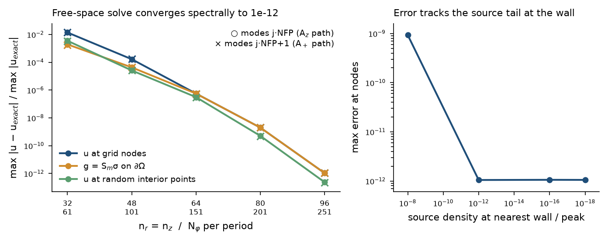

# Cylindrical-annulus J → B, stage A report (stop point S1)

Branch `cylindrical-grid`, commits 7279bda (A1) … 0893e08 (A6). Plan: `docs/cylindrical_grid_plan.md`.
All gates run with `python tests/test_cylindrical_bs.py` (about 75 s locally); the full A6 sweep runs with `python tests/cyl_a6.py`, which writes `results/cyl/a6.json`.

## New code (NumPy reference, opt-in, nothing in main's paths touched)

| File | Content |
|---|---|
| `nest/chebyshev.py` | `ChebAxis`: CGL nodes, optional KTE map, D, D² (barycentric), interpolation matrices, Clenshaw–Curtis weights, `for_spacing` |
| `nest/annulus_poisson.py` | `AnnulusPoisson`: per-\|m\| matrix diagonalization on the annulus rectangle, Dirichlet solve, solve with boundary data, face flux σ, packed 4-face boundary |
| `nest/toroidal_kernel.py` | Q_{m−½}(χ) for all m from χ − 1 (elliptic start, forward or Miller recurrence), k_m |
| `nest/single_layer.py` | S_m from face nodal σ to S_m σ at any (r, z): graded Gauss–Legendre panels, u⁶ log-singular end panels, exact offsets |
| `nest/annulus_freespace.py` | `FreeSpaceAnnulus`: φ-FFT, James correction per mode, shifts 0 (A_z) and 1 (A₊) |

## Gate results

| Gate | Result | Criterion |
|---|---|---|
| A1 operators | Polynomials exact (D 1e-12 at n = 128); sin(5x)eˣ to 1e-13 by n = 32 | ✓ |
| A2 eigen | Unmapped: real negative spectra for all \|m\| ≤ 738 (a/30 size); reconstruction ≤ 6e-15; **κ(V_r) ≤ 4** | ✓ |
| A3 Dirichlet | Eigen against dense solve: residual ≤ 4e-16, forward difference within κ·eps (κ(A) ≈ 4e5). Manufactured u: 6e-9 at n = 16 → ≤ 5e-15 at n = 24 (rounding level; ≤ 1.2e-14 at n = 32–64), for m from 0 to 400. σ self-converges to 1e-13. | ✓ (criterion (a) amended, see below) |
| A4 Q_{m−½} | Against mpmath ≤ 3e-15 for m ≤ 5. Worst is 5e-11 at m = 1000, χ − 1 = 1e-12 (forward range). Switch continuous to 7e-14; k_m against the t-integral ≤ 2e-14 | ✓ |
| A5 S_m | Against the 3-D surface integral ≤ 4.3e-15 (**sign and 2π confirmed**); on the surface against adaptive quad ≤ 2e-12 to m = 300; corner rows identical; panel rule converged to 2e-12 | ✓ (entry criterion amended) |
| A6 free space | Gaussian charges, both shifts: **1.1e-12 at n = 96, N_φ = 251**, converging spectrally (figure below); g on ∂Ω at the same level | ✓ |

## Findings that change the plan

1. **No coordinate mapping (α = 0).** The Kosloff–Tal-Ezer map makes the collocation operator non-normal enough to give complex eigenpairs at isolated \|m\|: α = 0.5 at m = 514, α = 0.9 at m = 434, and α = 0.5 even at m = 0 for some n. The map would only have saved about 20% of the radial nodes for precise_QA, because the plasma fills most of [R_in, R_out]. The unmapped axis is clean, with κ(V) ≤ 4. A Legendre–Galerkin basis (symmetric generalized eigenproblem) would be the route to near-uniform nodes if the 2.5× wall clustering ever matters.
2. **The annulus removes the conditioning problem.** The proposal's κ(V_r,m) concern comes from the full cylinder's axis. On the annulus, κ ≤ 4 for every \|m\| tested.
3. **Margin.** The error tracks the source's density at the wall (a tail of 1e-8 gives 9e-10). NEST's J is exactly zero beyond its support, so there is no tail. The margin question for NEST is resolution of J's edge kink near the wall, to be measured in B4 with δ ∈ {1, 2, 4} h.
4. **Quadrature default.** The single-layer rule needs 16 Gauss points per panel with grading ratio 0.15. The first choice (10, 0.25) gave 1.6e-10 at m = 300.

## Amended criteria (recorded, not hidden)

- A3(a): "≤ 1e-11 relative" was replaced by backward error ≤ 1e-14 plus a forward difference within 10 κ(A) eps. Random data with κ(A) ≈ 4e5 cannot meet 1e-11 in any backward-stable solver.
- A5(iii): entry stability (plan 1e-13) became 1e-11. In the test, the bound on the entry change `dp` moved 1e-12 → 1e-11; its other bound (`dc` < 1e-13) is unchanged. The floor at high m is Q's recurrence accuracy near χ = 1 (gate A4).

## Cost at the real precise_QA sizes (laptop CPU, NumPy)

| Size | n_r, n_z, N_φ | Distinct \|m\| | N_b | S_m precompute | S_m storage | One scalar solve |
|---|---|---|---|---|---|---|
| a/10 | 70, 81, 251 | 252 | 306 | 32 s (measured) | 189 MB (measured) | 0.7 s (A_z), 1.3 s (A₊) |
| a/20 | 133, 155, 493 | 495 | 580 | ~4 min (scaled ×8) | 1.3 GB (computed) | ~6–10 s (scaled) |

At a/10 the eigendecompositions take 0.3 s. The JAX apply path (B1) will replace the NumPy solve; the precompute stays NumPy and is cached.

## Decisions for the user at S1

1. Confirm α = 0 (no mapping), with Legendre–Galerkin kept as a later option only.
2. Confirm the default margin δ = 2 h, with the δ study moved into B4 on NEST's J.
3. Confirm that the a/20 precompute (~4 min, 1.3 GB dense S_m) is acceptable locally for B4. Banded S_m (E1) would come before a/30.
4. Go to stage B (JAX vector J → B, manufactured exact field, NEST J against the VG box).
