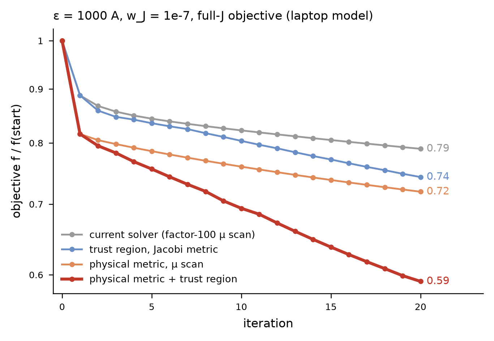

# HarmonicModel LM: physical-metric damping and a trust region (`--speed phys,tr`)

2026-10-23, branch `lm-trust` (from `dshape-perturbed-wJ1e-7` at `07573ec`). For the DSHAPE 2/1 island runs.

## 1. What changes, in one paragraph

Two new `--speed` options for `isl_scan.py` (`HarmonicModel(speed=...)`), usable with the existing ones
(`resident, chol, narrow, merge, gpus, reuse, soc`; verified identical trajectories with and without `chol,narrow`):

- **`phys`**: the LM damping is measured in the *physical* metric instead of the Jacobi-scaled coefficients:
  step `d = L^-T y`, damping `mu |y|^2`, where `L L^T = M = sum_points w (J_i.J_j / rms_J^2 + p_i p_j / rms_p^2)`
  is the Gram matrix of the columns' J and p at the collocation points (the volume-weighted rms change of J and p).
  M depends only on the tables, so it is built and Cholesky-factored **once per run** (no field solves; 1.8 s on the
  laptop model, ~2 GB at N = 2). Per step it costs one triangular solve on R (`_Scale` in `harmonic_dense.py`).
- **`tr`**: a trust region in those variables replaces the factor-100 mu grid after the first iteration
  (the first iteration runs the usual scan to set the radius). mu is found from `|y(mu)| = Delta` (safeguarded
  Newton on the secular equation, a few Cholesky factorizations of the already-formed scaled Gram matrix; the step
  itself by the damped QR when mu/lambda_max < 1e-10), the step is evaluated exactly, and Delta follows DESC's rule
  (x2 when actual/predicted > 0.75 on the boundary, 0.25 |y| below 0.25). A rejected trial shrinks Delta and is
  retried within the same iteration, so `lm` still never takes an increasing step. The log line shows
  `ratio` and `tries`.

## 2. Why: what limits the current loop

Measured on a small model (Section 3) and read off your stage histories (`results/isl/a120Ce*`):

1. **The freeze comes from small w_J combined with eps > 0, not from the perturbation alone.** Every w_J = 1e-3 stage
   converges quadratically (13-31 its, mu -> 1e-16); creeping with a fixed mu/lambda ~ 1e-6 ... 1e-8 starts at w_J ~ 1e-4
   to 1e-5 (e.g. 1000 A: 14 its at 1e-3, 77 at 1e-4, still moving after 124 at 1e-5).
2. **Most of the weakly determined directions are representation directions** (radial collinearity of the a/b/chi
   basis): on the small model a 30% coefficient move along them changes J by 0.5% and p by 0.16%. A diagonal (Jacobi)
   scaling cannot remove that; the physical metric does (production n = 1 block, earlier measurement: kappa 7e8 with
   Jacobi, 1.7e6 in the physical metric).
3. **The factor-100 mu grid is too coarse.** With the physical metric the trust region settles at
   mu/lambda_max ~ 2e-9 ... 6e-9, between grid points; the scan alone keeps choosing 1e-8.
4. Your `soc` is exact geodesic acceleration (the residual is exactly quadratic in z with `par = 1`, `w_pos = 0`),
   but it was applied only to the step the scan had already chosen, where q(d, d) is small; that is why it changed
   nothing. Not re-tested here.

## 3. Evidence (laptop model, your objective)

Model: `tokamak_L16M16_fb` + `_field`, basis factors 1, a/20, N = 1 (750 unknowns); objective as `a120Cn2d1000`
(force + w_J (J - J_start) on the full 3-D J at every point and every radius, J_start = J of the axisymmetric fit,
`w_W = w_pos = 0`). Base (eps 0) and the w_J = 1e-3 stage at 1000 A are converged first (3 and 5 exact its), then
20 iterations per variant at w_J = 1e-7 from that same state. Script: `scripts/lm/lm_ab.py`.



| variant (`--speed`)              | f_20 / f_0 | removable f left (f x GN share) / f_0 | wall (20 its) |
|----------------------------------|-----------:|---------------------------------------:|--------------:|
| (none) = your loop               | 0.790      | 0.27                                   | 218 s         |
| `chol,narrow`                    | 0.790      | 0.27 (identical trajectory)            | 176 s         |
| `tr` (Jacobi metric)             | 0.743      | 0.22                                   | 175 s         |
| `phys`                           | 0.719      | 0.19                                   | 213 s         |
| **`phys,tr`** (+ `chol,narrow`: identical) | **0.591** | **0.09**                       | 199 s         |

The removable part of f at the start is 0.52 f_0: your loop removes 48% of it in 20 iterations, `phys,tr` 82%,
at the same cost per iteration. In log f per iteration that is 2.2x.

Caveats: one small model, one state, 20 iterations; **not yet tested at 16k unknowns**. The metric is
ill-conditioned (diagonal spans 3e-15 ... 6e-7 here); it is regularized with 1e-10 x mean(diag) and the code asserts
the Cholesky succeeded. Not supported with `newton` or `--steps lsqr` (asserted).

## 4. What we would like you to run (Stellar AI, ~1 GPU-hour total)

A/B from your N = 2 end state at 1000 A, 30 iterations each, same flags as `a120Cn2d1000` (rsync the code first):

```bash
COMMON="scripts/dshape/isl_scan.py --base results/gs/hN_a120D --N 2 --eps 1000 --w-J 1e-7 --j-mode full \
  --w-W 0 --w-pos 0 --iters 30 --rtol 1e-12 --gn-tol 0 --batch 16 8 --start-from a120Cn2d1000"
FAST="resident,chol,narrow,merge=100000,gpus=4"
sbatch --gres=gpu:nvidia_b200:4 --mem=500G --job-name=abA run_sai.sbatch $COMMON --speed $FAST          --name abN2A1000
sbatch --gres=gpu:nvidia_b200:4 --mem=500G --job-name=abB run_sai.sbatch $COMMON --speed $FAST,phys,tr  --name abN2B1000
# optional, separates the two ingredients:
sbatch --gres=gpu:nvidia_b200:4 --mem=500G --job-name=abC run_sai.sbatch $COMMON --speed $FAST,phys     --name abN2C1000
```

At ~13 s per step each job should take ~10-15 min including table load and compilation. Please send back the two
(three) logs (the `it` lines and the `physical metric: built ...` line) and, if B is clearly better, `isl_islands.py`
for A and B so we can see whether b_21 and the width move too. If 1000 A works, the same at 300 A
(`--start-from a120Cn2d300`) and 3000 A (`a120Cd3000w2`) is the next check.

## 5. Important: a faster solver does not make the w_J = 1e-7 answer more meaningful

The slow directions that remain after the metric fix are physical: the axisymmetric profile family (any p(psi), I(psi)
is an equilibrium) and the resonant freedoms at the rational surfaces, pinned only by w_J. At small w_J the state moves
along them by ~ (residual component)/(singular value), i.e. its position there is set by discretization error and by
w_J, and your stage results already move with w_J (leftover b_21 at 3000 A: 0.25 -> 0.45 -> 0.87 for w_J 1e-3 -> 1e-4
-> 1e-7; the eps = 0 force floor 1.31e-9 -> 9.4e-10 -> 5.4e-10, not flat). So the proposed use of the faster solver is
a **w_J plateau test**: converge each of w_J = 1e-3, 1e-4, 1e-5, 1e-7 at 300 / 1000 / 3000 A (N = 2, N = 3 at 3000 A),
preferably with `--j-mode n0` (the full-J penalty also pins the helical response, i.e. the island itself), and claim
b_21, widths and the pressure flattening only where they stop moving with w_J. We are also patching the island
diagnostics to use each state's measured q = 2 radius and shear (your open item 2).
