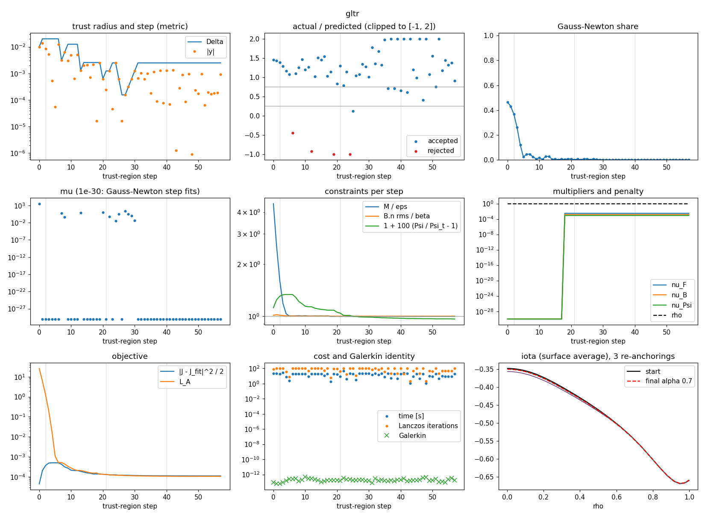
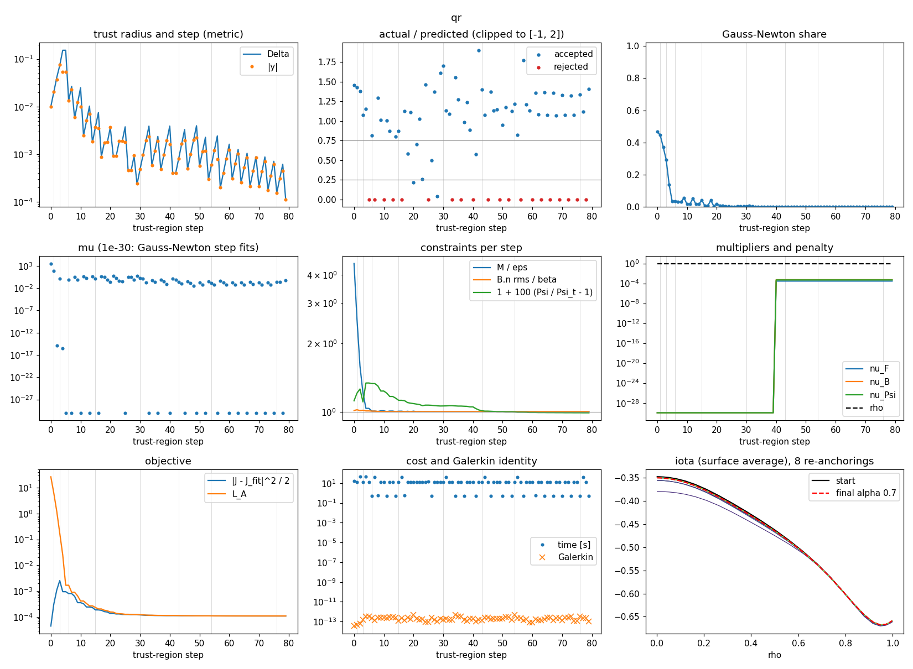
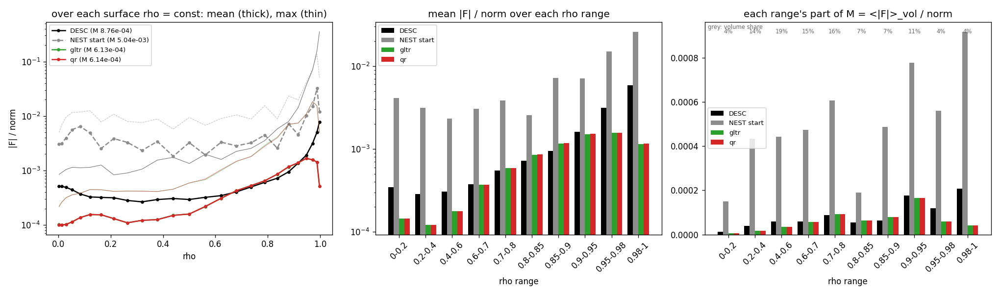

# Health review, α = 0.7: GLTR and QR on NCSX_fb_L16M16N12, NEST 16/16/12, annulus a/40, free boundary

2026-10-26. Step 2 of `docs/mean_force_poisson_plan.md`: the matrix-free method's first run, for the health review. Stellar-AI job 6150 (one B200), 19 min in total. Code: branch `closest-poisson` (`nest/meanforce.py`, `scripts/meanforce/mf_run.py`). Data: `results/meanforce/gltr_a40.json`. Figure: `figures/meanforce/health_gltr.png`.

## What was solved

$$
\min_{u,\,\xi}\ \tfrac12\|g\|^2 \quad\text{s.t.}\quad M \le \varepsilon = 0.7\,M_\text{DESC},\qquad \frac{\|B\cdot n\|_\text{rms}}{|B|} \le \beta = 4.53\cdot10^{-3},\qquad \Psi = \Psi_\text{start},
$$

- **Objective:** g = √w (J − J_fit)/rms J_fit, with J_fit (DESC's J fitted in the basis) carried with the moving coordinates.
- **Mean force:** M = Σ w_i |F_i| / norm is DESC's ⟨|F|⟩_vol / ⟨|∇|B|²/2μ₀|⟩_vol on the moved geometry, with F = J×B − ∇p*.
- **Pressure:** p* is the weighted least-squares (weak Poisson) pressure of the current state, recomputed exactly at every evaluation.
- **Unknowns:** u (4,234 current coefficients) and ξ (413 boundary modes, M = 16, N = 12).
- **Grid:** 89,725 collocation points (25 × 97 × 37); annulus of 164 × 262 × 475 planes (20.4 M nodes); B·n on 1,625 boundary points.
- **Method:**
  - Augmented Lagrangian with three multipliers and one penalty ρ.
  - Trust-region steps by GLTR (Lanczos, at most 100 iterations) in the physical metric: the rms change of J / rms J_fit, plus √κ times the rms boundary displacement, with κ = 174 probed so the ξ and u columns have the same mean size.
  - Re-anchoring when the boundary has moved 2 mm.

## Gates (at the start)

| check | result |
|---|---|
| DESC's own \|F\| integrated on NEST's points vs DESC's quadrature | 8.762e-4 vs 8.779e-4 (**−0.19%**; gate < 1%) |
| B·n/\|B\| rms of the start, annulus (plain mean, as DESC) vs DESC's | 4.582e-3 vs 4.53e-3 |
| annulus vs direct Biot–Savart, same points, same mean | 4.582e-3 vs 4.585e-3; pointwise difference 7.2e-5 rms, 6.2e-4 max (switch threshold β/3 = 1.5e-3) |
| Galerkin identity max_j \|P_jᵀ f\| / (\|P_j\|\|f\|) | 2.1e-14 |
| NEST's start with the Poisson pressure | **M = 5.04e-3 = 5.74 M_DESC**, rms \|F\| 8.73e-3 |

The CPU gates of the formulation (`tests/test_meanforce.py`: manufactured Poisson, trailing block, Galerkin, J v vs differences including ∂Π/∂ξ, adjoint, envelope, dense vs matrix-free rows, ∇L_A) all pass; see `UPDATES.md`.

## Result

| | start | final |
|---|---|---|
| ‖J − J_fit‖ / rms J_fit | 0 | **1.50e-2** |
| M / M_DESC | 5.74 | **0.698** (ε: 0.700) |
| rms \|F\| / norm | 8.73e-3 | 1.00e-3 |
| B·n/\|B\| rms, annulus | 4.582e-3 | 4.528e-3 |
| B·n/\|B\| rms, direct Biot–Savart (same points) | 4.585e-3 | 4.533e-3 (difference 7.0e-5 rms, 5.5e-4 max) |
| Ψ / Ψ_t − 1 | 0 | −3.8e-4 |
| multipliers ν_F, ν_B, ν_Ψ | 0 | 1.8e-4, 3.8e-4, 4.5e-4 |
| slope of the front −ν_F/ε | | −0.30 (d(‖g‖²/2)/dε) |
| boundary motion | | 3 re-anchorings of 2.0–2.6 mm, then 1.9 mm in the last anchor |

- **Constraints:** all three were met within 1% after two outer iterations.
- **Force reduction:** reaching 0.7 M_DESC took a change of J of 1.5% rms. The mean force fell by 8.2× and the rms force by 8.7×.
- **iota:** essentially unchanged. The surface average moved by at most 2.7e-3, at the axis (−0.3475 → −0.3497), and by 6e-4 or less from ρ = 0.5 out, so I(ρ) left free did not drift.

## Health review



| item | finding |
|---|---|
| steps | 58: 54 accepted, 4 rejected (steps 6, 12, 19, 24; ratios −0.4 to −3.7) |
| actual/predicted ratio | > 0.75 in 83% of steps, < 0.25 in 9%. **Mostly above 1 (median ≈ 1.25, up to 2.9)**: the model under-predicts the decrease |
| trust radius | 1e-2 → 2e-2 in the first steps, then 1.5e-4 … 2.5e-3; **no collapse**, flat at 2.5e-3 for the last 27 steps |
| on the boundary | 21% of steps; μ = 0 (the Gauss–Newton step fits) in 79% |
| Gauss–Newton share | 0.47 at the start, < 0.05 after step 5, ≈ 2e-4 at the end; the residual left is not reducible at first order. This is the opposite of the pointwise study's failure (share ≈ 1 with a collapsing radius) |
| stall detector | did not fire |
| penalty ρ | 1 throughout (never raised); the multipliers are small |
| re-anchorings | M before/after: 9.931e-4 → 9.933e-4, 6.129e-4 → 6.129e-4, 6.128e-4 → 6.128e-4; B·n and Ψ continuous to 1e-6. The first-order treatment of ξ inside an anchor is accurate at 2 mm |
| Galerkin identity | ≤ 4.7e-13 at every step |
| cost | 19 s per step (median), 30 s per re-anchor, 17 min for α = 0.7, 53 s for the Hessian; GPU peak 27 GB |
| Hessian at the final state | H_Lag on the tangent space of the 3 active constraints: Ritz values 1.01 … 1.7e3, **none negative** (40 Lanczos steps). Its ‖g‖² part alone: 2.4e-5 … 1.1 |

### Findings to discuss

1. **The run is feasible but not fully converged in the objective.**
   - **The stopping test:** the outer loop stopped because all three constraints were within 1%. The first inner solve ended after 18 steps on its relative-gradient test. The second used its full budget of 40 steps without meeting any stationarity test.
   - **The objective was still falling:** ‖g‖²/2 dropped 1.393e-4 → 1.118e-4 in outer 1, and its last 10 steps still lowered it by about 4e-8 each.
   - **The front's value at α = 0.7 is therefore an upper bound.** The extrapolated limit is a few percent lower.
   - **A fix for the sweep:** require a relative change of ‖g‖ below a tolerance (or the gradient test) before an outer iteration counts as converged.
2. **The inner model is conservative, and steps shrink without the radius shrinking.**
   - **Symptoms:** ratios above 1 and steps far inside the radius (|y| 1e-6 … 1e-3 under Δ = 2.5e-3).
   - **Cause:** the majorizer of M (rows w F/√t with t = |w F|) puts curvature 1/t on the points where |F| is small. That over-estimates the mean force's curvature, so the Gauss–Newton step is short and each step gains little.
   - **Options:**
     - a larger smoothing τ (now 1e-3 ε norm) or a floor on t, so the weights are less extreme;
     - or exact Hessian–vector products of M inside GLTR, so the model matches the true curvature.
3. **Lanczos often reached its cap.**
   - **How often:** 100 iterations in 52% of steps (median 100). Those steps solved the subproblem to less than the 1e-2 tolerance.
   - **Effect:** probably a contributor to 2. It is not harmful, since the ratio test protects it.
   - **Options:** raise the cap to 200, or precondition with the u-block metric (already the identity here) and a ξ-block preconditioner.
4. **The B·n of the free boundary sits on its bound,** with ν_B > 0, and the annulus agrees with direct Biot–Savart to 7e-5 rms. No switch to `DirectField` is needed.

## The QR run (job 6149) and the two methods compared

Same problem, same start and settings; dense steps by QR of the stacked Jacobian [J L^-T | r] (540,000 × 4,648) on one B200. The u columns come from per-anchor tables (4,234 field solves, 2 min), the ξ columns from 413 Jacobian-vector products per accepted step.



| | GLTR | QR |
|---|---|---|
| ‖J − J_fit‖ / rms J_fit | 1.4957e-2 | **1.4904e-2** (‖g‖²/2 0.7% lower) |
| M / M_DESC | 0.6980 | 0.6999 |
| B·n/\|B\| rms (annulus) | 4.528e-3 | 4.529e-3 |
| Ψ / Ψ_t − 1 | −3.8e-4 | −1.1e-4 |
| ν_F, ν_B, ν_Ψ | 1.8e-4, 3.8e-4, 4.5e-4 | 1.5e-4, 1.8e-4, 3.9e-4 |
| iota change (max) | 2.7e-3 | 2.8e-3 |
| steps (accepted / rejected) | 58 (54 / 4) | 80 (60 / 20) |
| outer iterations, inner steps | 2: 18 + 40 | 2: 40 + 40 |
| ratio > 0.75 / < 0.25 | 83% / 9% | 66% / 28% |
| re-anchorings | 3 | 8 |
| time per step (median) | 19 s | 13 s (0.5 s for a retry on the same QR) |
| table rebuild per anchor | none | 2 min |
| total for α = 0.7 | 17 min | 38 min |
| Hessian on the tangent space | 1.01 … 1.7e3, none negative | 1.15 … 1.3e3, none negative |
| GN (‖g‖²) part | 2.4e-5 … 1.1 | 2.4e-5 … 1.1 |
| Galerkin max | 4.7e-13 | 4.8e-13 |
| stall detector | not fired | not fired |

**The two methods reach the same state:**
- ‖J − J_fit‖ agrees to 0.35%, and all constraints are met.
- The Hessian spectra match: positive on the tangent space, with the same smallest J-distance eigenvalue.
- QR went 22 steps further in the objective, so it is slightly lower. Neither is fully converged (finding 1).

### Findings from the QR run

5. **Every rejected QR step is an undamped Gauss–Newton step.**
   - **The pattern:** all 20 rejections (25% of steps) are steps where the Gauss–Newton step fit the radius (μ = 0). All 60 accepted steps had μ > 0.
   - **The cause:** at those steps the model predicted no decrease (the logged ratio 0 means predicted ≤ 0), and the merit grew 10–10⁴× (e.g. 1.7e-3 → 8.4).
   - **Diagnosis:** the full-space Gauss–Newton matrix is near-singular. Its J-distance part has eigenvalues down to 2.4e-5, and directions not seen by the force rows are flatter still. So the triangular solve for the μ = 0 step is inaccurate.
   - **Effect:** the radius then shrinks to 1/4. This produces the saw-tooth in Δ, and the radius drifts down from 1e-2 to 2e-4 over 80 steps without a real collapse. Each retry costs only 0.5 s, but it halves the useful progress.
   - **Fix:** take the μ = 0 step only when its model decrease is positive (otherwise use the smallest μ on the boundary), or regularize the step with a μ floor of 1e-10 λ_max.
6. **One intermediate anchor showed an iota dip near the axis** (−0.38 against −0.35 at the start), which was gone by the next anchor. The final iota matches the start to 3e-3, as with GLTR.

### For the check-in

| question | evidence | proposal |
|---|---|---|
| is the radius healthy? | no collapse in either; QR's saw-tooth comes from the μ = 0 steps | fix 5 before the sweep |
| GN share | falls from 0.47 to ≈ 0 in both: the remaining residual is not reducible to first order; the opposite of the pointwise failure | none needed |
| model accuracy | ratios > 1: the mean-force majorizer over-estimates curvature | try a floor on t (τ = 1e-2 ε norm) or Hessian-vector products of M |
| convergence | both stop on feasibility while ‖g‖ is still falling | add a stationarity test to the outer loop (relative change of ‖g‖²/2 < 1e-4 over the last 10 steps) |
| ρ and multipliers | ρ = 1 all through, multipliers ~1e-4 | fine |
| re-anchoring at 2 mm | continuous to 3e-4 in M | keep |
| B·n from the annulus | 7e-5 rms off direct Biot–Savart | keep the annulus |
| GLTR | Lanczos at its cap in 52% of steps | raise the cap to 200 |
| cost | GLTR 17 min, QR 38 min for one α at a/40 | fine for the sweep and study 1 |

## Reproduce

```bash
sbatch --qos=gpu-medium --time=24:00:00 run_sai_cyl.sbatch scripts/meanforce/mf_run.py --method gltr --alphas 0.7 --frac 40 --chunk 32 --out results/meanforce/gltr_a40
```

```bash
python scripts/meanforce/health.py gltr=results/meanforce/gltr_a40.json --out figures/meanforce/health
```

## Where the force error is (`scripts/meanforce/radial_force.py`)

|F|/norm averaged over each coordinate surface ρ = const (volume-weighted over θ, ζ at the 25 collocation radii) and over ρ ranges, for DESC's own solution (its |F| on NEST's points), NEST's start and the two end states. Each state uses its own flux coordinates: the moved geometry for the end states. NEST's B need not lie on these surfaces, so this is an average over the coordinate surface, not a flux-surface average. Data: `results/meanforce/radial_a40.json` (Stellar-AI job 6173).



| ρ range | volume | DESC mean | NEST start mean | end (GLTR) mean | DESC part of M | end part of M |
|---|---|---|---|---|---|---|
| 0–0.6 | 37% | 2.9–3.5e-4 | 2.3–4.1e-3 | 1.2–1.8e-4 | 1.10e-4 | 0.56e-4 |
| 0.6–0.95 | 56% | 3.8e-4 … 1.6e-3 | 2.6e-3 … 7.2e-3 | 3.7e-4 … 1.5e-3 | 4.39e-4 | 4.57e-4 |
| 0.95–0.98 | 4% | 3.1e-3 | 1.5e-2 | 1.6e-3 | 1.18e-4 | 0.59e-4 |
| 0.98–1 | 4% | 5.9e-3 | 2.6e-2 | 1.2e-3 | 2.08e-4 | 0.41e-4 |
| all (M) | | 8.76e-4 | 5.04e-3 | 6.13e-4 | | |

- **Against NEST's start:** the reduction is everywhere, 8–23× in every range. It is largest in the core (28×) and at the edge (23×).
- **Against DESC:** the end state is 2.0–2.4× below DESC in the core (ρ < 0.6), about equal to DESC at 0.6–0.95 (0.95–1.2× DESC's), and 2–5× below DESC for ρ > 0.95.
- **Where the gain over DESC comes from:** M is 2.64e-4 below DESC's. Of that, 2.27e-4 (86%) comes from the outer 5% in ρ (8% of the volume) and 0.55e-4 from the core. The mid-radius band is slightly worse (+0.18e-4).
- **The edge advantage is partly structural.** NEST's current vanishes on the LCFS (edge factor) and p* = 0 there, so |F| → 0 at ρ = 1 by construction. DESC's |F| rises to its largest values there. The max over each surface shows the same: NEST's end state has its largest |F| (≈ 2e-2) at ρ ≈ 0.97, where DESC's is 3e-2 to 3e-1.
- **The 0.6–0.95 band, where the islands and rational surfaces sit (iota 0.5 at ρ = 0.59, 0.6 at ρ = 0.80), is where the end state is no better than DESC.** At α < 0.7 it is where further reduction must come from.
