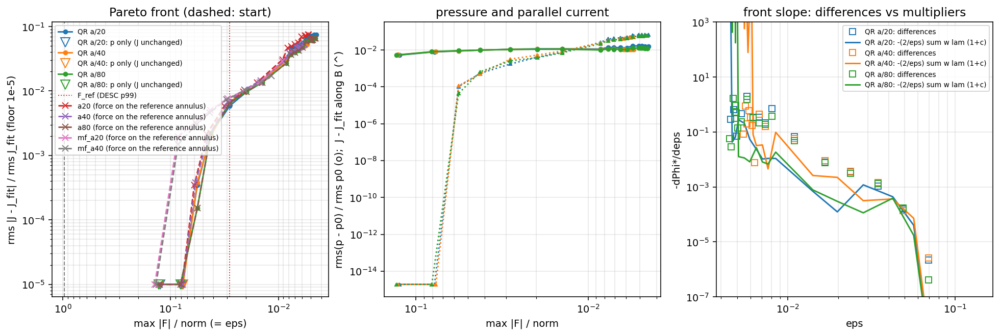
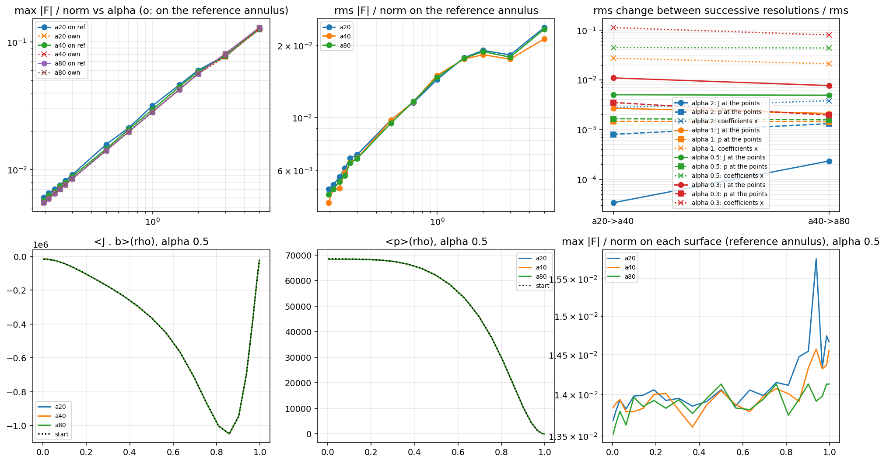
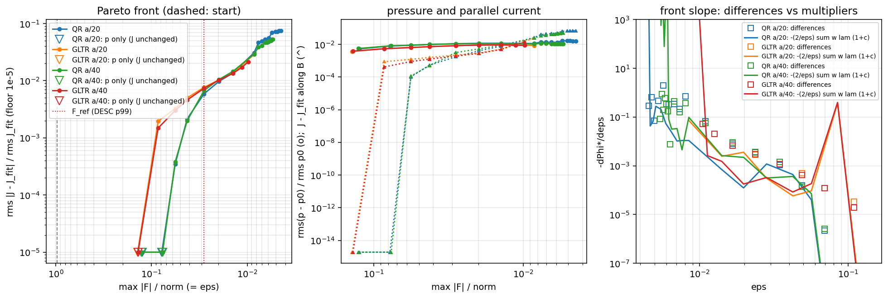
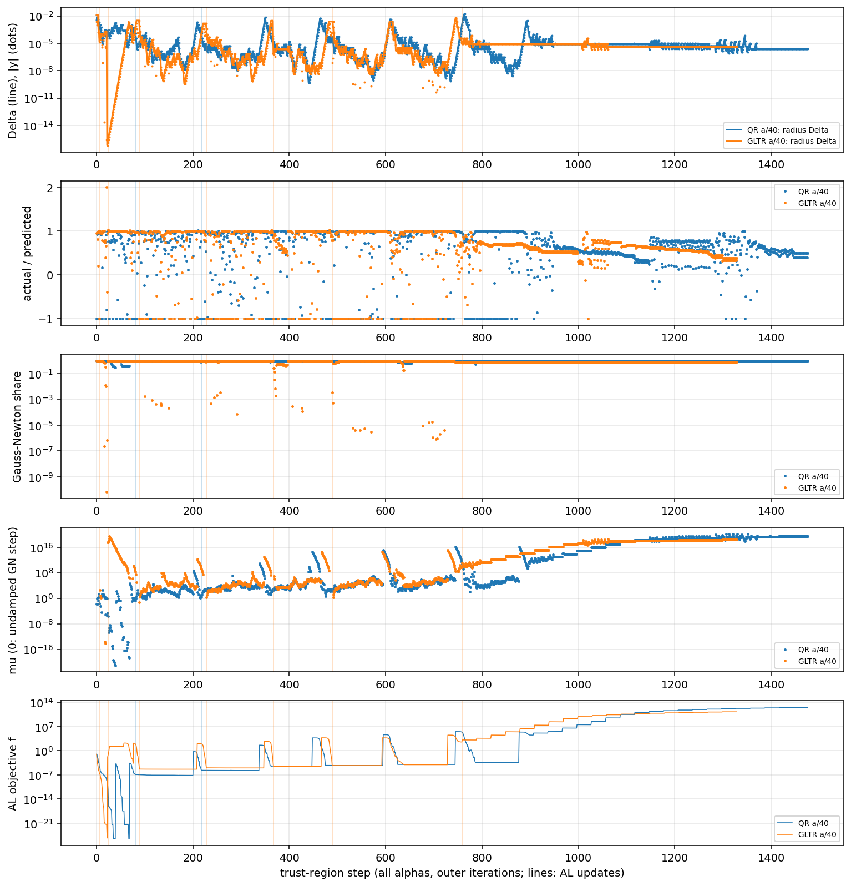
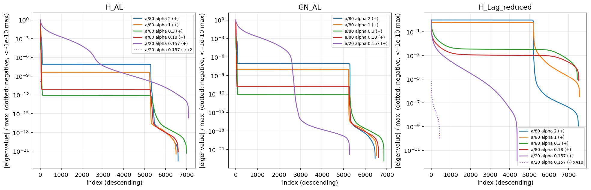
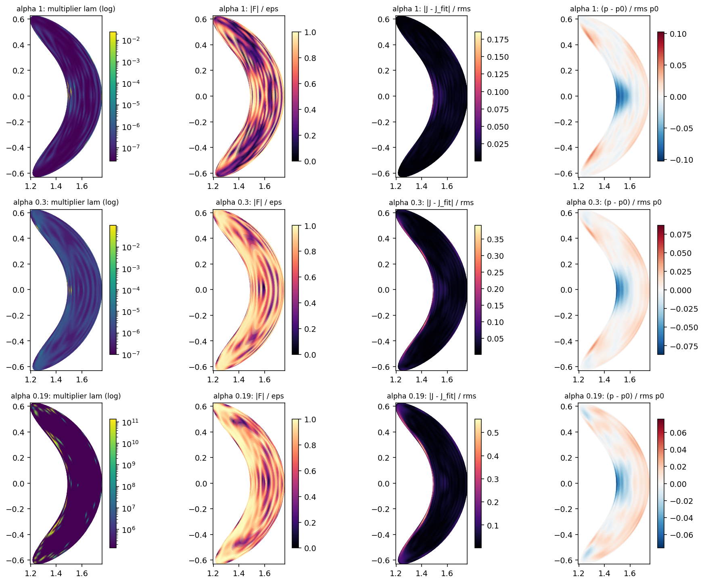
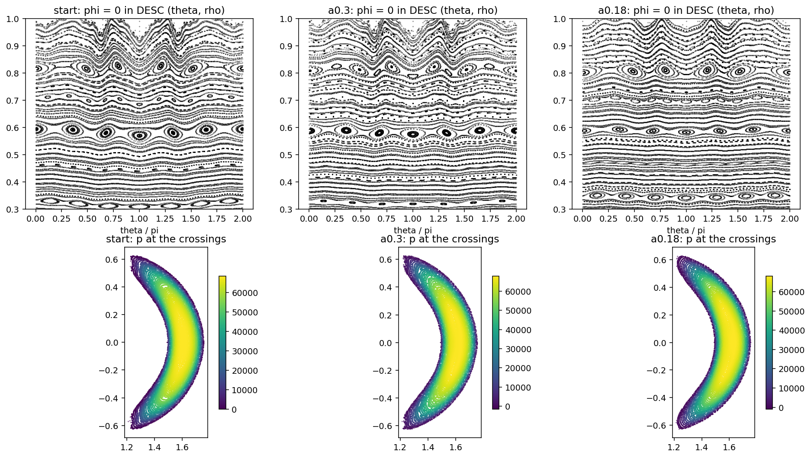
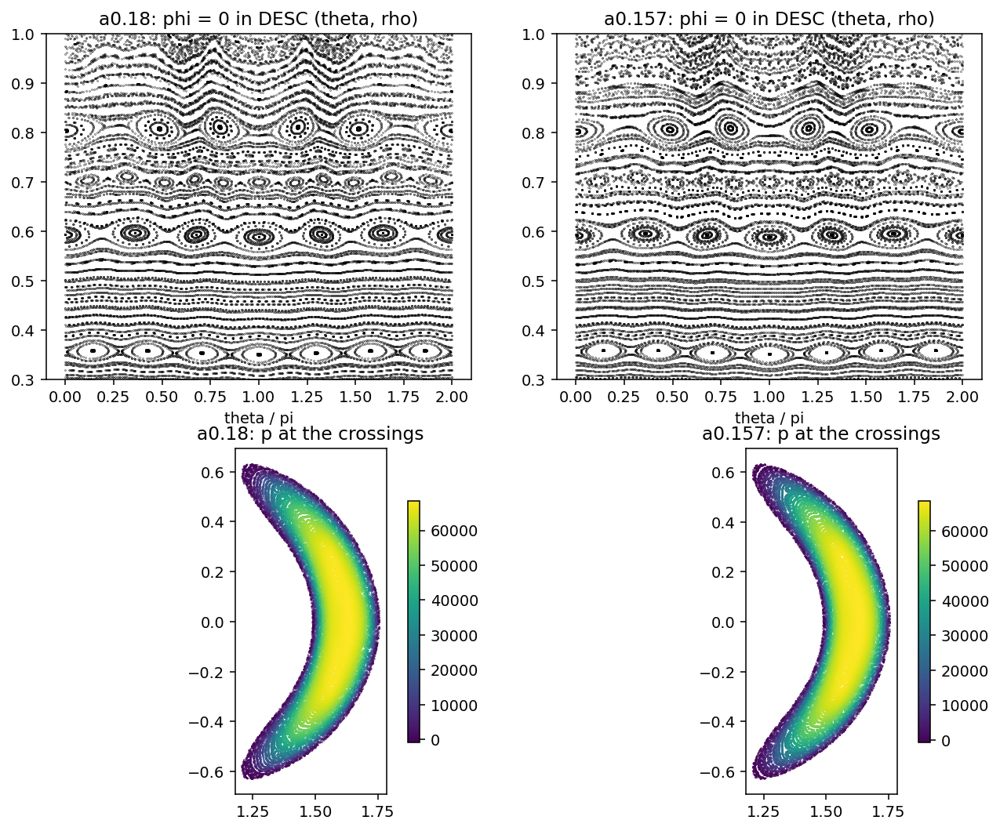
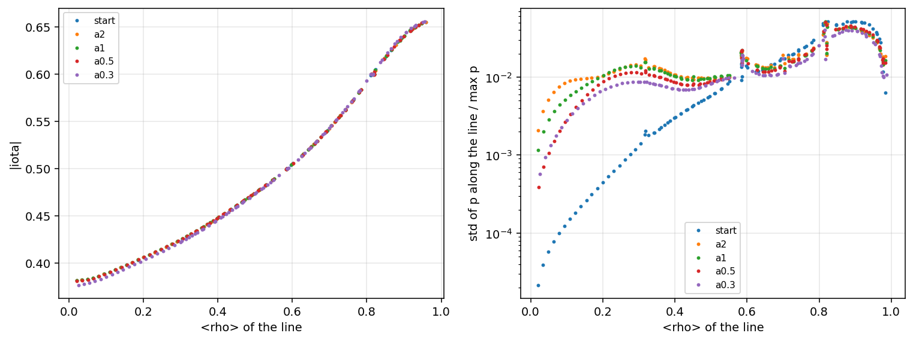
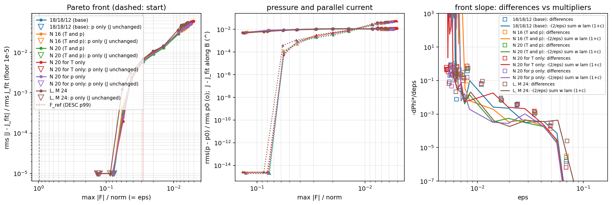

# NCSX: the closest state to DESC's current with a pointwise force bound

2026-10-26. Branch `closest-al` (worktree `/Users/lee/codes/NEST_al`, from `origin/main`). Runs on
Stellar-AI (B200), copy `/scratch/gpfs/EKOLEMEN/lk1158/NEST_al`.

**Summary.**

- **Both trust-region solvers work on the pointwise augmented Lagrangian.**
  - The exact-QR one (jaxmg, cuSOLVERMp, 2–4 GPUs) is the more robust: it reaches deeper bounds and closer states.
  - The matrix-free Lanczos one (GLTR) reaches the same states at moderate α, but needs about 3× the trust-region budget near α = 0.3, and its cost grows with the annulus resolution (one solve per Krylov vector).
- **With the 18/18/12 basis, the largest local force can be brought below α ≈ 0.16 of DESC's 99th percentile.** That is |F| ≤ 4.5·10⁻³ norm everywhere: 5% of DESC's own largest local force.
  - The rms force (3.7–4.0·10⁻³) is then below DESC's own (4.9·10⁻³).
  - The price is a 6.6–7.5% rms change of J.
- **The Pareto fronts at a/20, a/40 and a/80 lie on top of each other.**
  - Re-evaluated on the a/80 annulus, the a/20 and a/40 states keep their bound to within about 10% and 4%.
  - J changes between resolutions by 0.5–1% rms, and that change hardly shrinks with h: the front converges, the individual state less.
- **Hessians.**
  - The reduced Lagrangian Hessian is positive definite on the tangent space of the active constraints for the states at α ≤ 0.5 (strict local minima). It is positive semidefinite at α ≥ 1, with flat pressure directions.
  - Two exceptions: the a/40 state at α = 0.3 has 2 small negative eigenvalues, and the deepest a/20 state has 418 (the end of the continuation is a saddle).
- **Trust region.** The Gauss–Newton share stays near 1 at every step, but the steps always end on the radius (median 1.5·10⁻⁶ in the physical metric). The bound c_i is quartic in u, so the Gauss–Newton model holds only in a small radius.
- **Topology** (a/20 and a/80 alike, figures below):
  - The 3/6 chain (ρ ≈ 0.59) shrinks as α decreases.
  - The 3/5 chain (ρ ≈ 0.81) reorganizes.
  - A 3/7 chain (ρ ≈ 0.35) grows.
  - iota is unchanged to about 0.01.
- **The free pressure is less constant along field lines than DESC's p in the core.** The bound only limits |B·∇p| ≤ |B|ε·norm, and p is not determined where the bound is inactive.


## 1. Problem

$$
\min_{u,\,c}\ \Phi = \tfrac12\,\|g\|^2,\qquad
g = \frac{\sqrt{w}\,\big(J(u) - J_\text{fit}\big)}{\text{rms}\,J_\text{fit}},
\qquad\text{subject to}\qquad
\frac{|F(x_i)|}{\text{norm}} \le \varepsilon\quad\text{at every collocation point } x_i .
$$

- **Unknowns** x = (u, c).
  - u: the coefficients of the current potential T (J = ∇×T, `BoundaryPotential`; div J = 0, J = 0 on the LCFS, net current I fixed).
  - c: the pressure's, p = (1 − ρ²) Σ_j c_j φ_j with φ_j stellarator-symmetric Fourier–Zernike functions (p = 0 on the LCFS).
- **No Poisson equation is solved:** p enters only through the bound.
- **Force:** F = J × B − ∇p, with B = B_ext (coils) + B_plasma(J). B_plasma comes from the cylindrical annulus solver at spacing h = a/frac (`cylindrical_bs`: Chebyshev in r and z, N_φ ≈ 2πR_out/(NFP h) planes per period, James' free-space correction).
- **Weights and norms:** w_i = dV_i/V, and norm = DESC's ⟨|∇|B|²/2μ₀|⟩_vol.
- **J_fit:** the least-squares fit of DESC's J in the T basis. It is the start, together with DESC's p(ρ) fitted in the pressure basis.
- **The bound:** ε = α F_ref, with F_ref the 99th percentile of DESC's own |F_i|/norm on the same points. α = 1 means the largest local force equals DESC's 99th percentile.
- **Equilibrium:** NCSX_L12M12N8 in its coils.

## 2. Augmented Lagrangian

Write c_i(x) = |F_i|²/(ε norm)² − 1 ≤ 0 (squared, so that it is smooth where F = 0).

$$
\mathcal L_\rho(x;\lambda) = \Phi(x) + \frac{\rho}{2}\sum_i w_i\Big[m_\delta\big(c_i + \lambda_i/\rho\big)^2 - (\lambda_i/\rho)^2\Big],
\qquad
m_\delta(s) = \tfrac12\Big(s + \sqrt{s^2 + \delta^2}\Big).
$$

- **Multipliers** λ_i ≥ 0, one per point; penalty ρ.
- **Smoothing.** m_0(s) = max(0, s) is the Powell–Hestenes–Rockafellar form. δ > 0 smooths it, so the Gauss–Newton model stays accurate when points enter or leave the active set.
- **Least-squares form.** ℒ = ½|r|² + const, with the residual r = (g, √ρ √w_i m_δ(s_i)).
- **Outer iteration k:**
  1. minimize ℒ_ρ over x (inner trust region, section 3) with δ_k = max(10⁻² · 10⁻ᵏ, 10⁻⁶);
  2. λ_i ← ρ m_δ(c_i + λ_i/ρ), which is max(0, λ_i + ρ c_i) at δ = 0;
  3. ρ ← 10ρ if the largest violation max_i c_i⁺ did not fall by a factor of 4.
- **Stop:** max_i c_i ≤ 2·10⁻², i.e. |F| ≤ 1.01 ε, with δ at its floor.
- **Continuation in α:** 5, 3, 2, 1.5, 1, 0.7, 0.5, 0.3, … Each α starts from the previous state and multipliers. The run stops at the first α whose bound is not met (infeasible at that resolution).
- **KKT conditions at the solution:**

$$
\nabla\Phi + \sum_i \lambda_i w_i \nabla c_i = 0,\quad \lambda_i\ge0,\quad c_i\le 0,\quad \lambda_i c_i = 0 .
$$

- **Slope of the front.** The multipliers give the slope of the Pareto front:

$$
\frac{d\Phi^*}{d\varepsilon} = -\frac{2}{\varepsilon}\sum_i w_i\lambda_i(1 + c_i),
$$

  which is checked against finite differences between neighbouring α.
- **What p satisfies at the optimum.** Stationarity in c reads ∫ ∇φ_j · (λ F) dV = 0, i.e. ∇·(λ∇p) = ∇·(λ J×B) weakly. This is a Poisson equation weighted by the multiplier field; it is empty where the bound is inactive.

## 3. Trust-region Gauss–Newton: two independent solvers

Both minimize ℒ_ρ with the same trust region, in the same metric, with the same radius rule. They differ only in how the subproblem is solved.

### The metric

$$
\|y\| = \|L^\top d\|,\qquad L L^\top = M = \mathrm{blockdiag}(H_J, H_p),
$$

$$
H_J = \sum_i w_i\,\partial_u J_i\cdot\partial_u J_i / \text{rms}^2 J_\text{fit}\ (= \text{the Gram matrix of } g),\qquad
H_p = \sum_i w_i\,\varphi_j\varphi_l / \text{rms}^2 p_0 .
$$

|y| is the rms change of J and of p; this is the `phys` metric of the lm-trust branch. M is regularized by 10⁻¹⁰ × its mean diagonal per block and Cholesky-factored once.

### Subproblem and radius rule

$$
\min_y \tfrac12\,|r + J_r L^{-\top} y|^2\quad\text{s.t.}\quad |y| \le \Delta .
$$

- **Radius rule** (DESC's): with the ratio ρ_tr = actual/predicted decrease,
  - ρ_tr < 0.25 → Δ = 0.25|y|;
  - ρ_tr > 0.75 on the boundary → Δ = max(2|y|, Δ).
- **Acceptance:** a step is accepted when ℒ decreases.
- **Inner stop:**
  - the gradient |L⁻¹J_rᵀr| has fallen by 10⁻³;
  - or the relative decrease is below 10⁻¹²;
  - or the Gauss–Newton share is below 10⁻⁸;
  - or after 30 steps.

### (a) Matrix-free: generalized Lanczos trust region (GLTR)

- **Products.** J_r v and J_rᵀ w come from the annulus Fields: one annulus solve each (`FieldsModel`, the linearization `Fields._tangent` and its JAX transpose).
- **Lanczos.** Run on B = L⁻¹ J_rᵀ J_r L⁻ᵀ from g = L⁻¹ J_rᵀ r, with full reorthogonalization. This gives the tridiagonal T_k.
- **Subproblem.** Solved exactly in the Krylov space: μ = 0 (the Gauss–Newton step) when it fits, else the secular equation |h(μ)| = Δ, solved by Newton on the eigendecomposition of T_k.
- **Stop.** When β_k|e_kᵀh| ≤ 10⁻² |g| for both the trust-region and the Gauss–Newton solutions.
- **Relation to lm-trust.** This is the matrix-free counterpart of the lm-trust branch's `_tr_step`, which finds μ from the secular equation with dense Cholesky factorizations.
- **Steihaug's truncated CG** (stop at the first boundary crossing) was tried and rejected: on the test problem it ended at a 12% worse objective. Its boundary steps are nearly steepest descent, while a Gauss–Newton step needs about 170 CG iterations here.

### (b) Dense: multi-GPU QR (jaxmg)

- **Column tables.** B_plasma = G u + B_I, with G formed once (one annulus solve per coefficient: 18 s at a/20, 2 min at a/40, 16 min at a/80). J, ∇p and p are linear in the coefficients (tables A, gP, P).
- **Compressed rows.** The g rows are replaced by R_g (u − u0), with R_gᵀR_g = H_J: the same |g|² in n_u rows.
- **Constraint rows.** √ρ √w_i m_δ'(s_i) (2/(εn)²) F_i · ∂F_i/∂x, with
  - ∂F_i/∂u_k = A_k × B_i + J_i × G_k;
  - ∂F_i/∂c_j = −∇φ_j.
- **The stacked matrix** [J_r L⁻ᵀ | r] ((n_u + n_rows) × (n + 1)) is QR-factored by `jaxmg.qr` (cuSOLVERMp). Each GPU process builds its own row block, and R is all-gathered.
- **From R:** c = Qᵀr and the residual of the linear model.
  - Gauss–Newton share = |c|²/(|c|² + r⊥²).
  - Step by DESC's exact-QR rule: the undamped Gauss–Newton step y_N = −R⁻¹c when |y_N| ≤ Δ, else μ on the boundary. That is a safeguarded Newton on the secular equation with Cholesky of RᵀR + μI, or a log bisection with the damped QR of [R; √μ I] below 10⁻¹⁰ λ_max (as the lm-trust branch).
- **Environment.** jaxmg 1.4.1 needs JAX ≥ 0.10.1, while the NEST environment has JAX 0.9.2. The dense solver therefore runs in its own environment (`envs/nest_mg`, Python 3.12, JAX 0.11.2), reads the tables from disk and imports no DESC (`nest/pointwise.py` has no DESC dependency). It runs one process per GPU (`run_mg.sbatch`).

### Gauss–Newton share and the trust-region radius

Every step records:
- Δ, |y|, the ratio and μ;
- the Gauss–Newton share, the fraction of ℒ that the full Gauss–Newton step would remove.
  - QR: exact.
  - Lanczos: from the μ = 0 solution in the Krylov space.

## 4. Hessian at the local minimum (`scripts/pointwise/hessian.py`)

Exact, in the metric (eigenvalues of L⁻¹HL⁻ᵀ), from the tables:

- **H_AL = J_rᵀJ_r + Σ_i r_i ∇²r_i.** It uses ∇²c_i = (2/(εn)²)(D_iᵀD_i + F_i·∇²F_i), with ∂²F_i/∂u_k∂u_l = A_k×G_l + A_l×G_k (only the u–u block). It is checked against finite differences of the gradient (1e-10).
- **The Gauss–Newton part J_rᵀJ_r** alone.
- **The Lagrangian Hessian H_J + Σ λ_i w_i ∇²c_i,** reduced to the tangent space of the active constraints (the null space of their gradients): its positive semidefiniteness there is the second-order condition of the constrained minimum.

## 5. Resolution studies

- **Annulus:** a/20, a/40, a/80 with the same basis (potential and pressure 18/18/12; 5,210 + 2,380 unknowns, 64,883 points).
  - The states of all three are evaluated on the a/80 annulus (`check_states.py`).
  - The relative change of x, of ⟨J·b⟩(ρ) and of ⟨p⟩(ρ) between successive resolutions.
- **Basis, at a/40** (`--factors` / `--p-factors`):
  - N raised to 20 for T alone (TN20), for p alone (pN20), and for both (N20);
  - both N to 16 (N16);
  - L = M = 24 (LM24).

## 6. Results

### 6.1 Start and reference

On the 64,883 collocation points of the 18/18/12 basis (a/40):

| | max \|F\|/norm | 99th pct | rms | mean |
|---|---|---|---|---|
| start: J_fit, DESC's p in the basis | 0.97 | 0.196 | 3.29e-2 | 1.15e-2 |
| DESC's own residual | 8.6e-2 | **2.83e-2 = F_ref** | 4.94e-3 | 3.10e-3 |

The start's force is dominated by the fit of DESC's J in the T basis (largest near the edge).
- **α ≥ 3:** met by changing p alone. |J − J_fit| is at round-off, and the pressure absorbs the force at the few worst points.
- **α = 1:** puts the largest local force at DESC's 99th percentile.

### 6.2 Pareto front and convergence with the annulus (QR solver)



The figure has three panels:
- **Left: the front,** rms |J − J_fit| / rms J_fit against the largest force.
  - The QR runs at a/20, a/40 and a/80 overlay.
  - The states of every run re-evaluated with the a/80 field (×) overlay as well.
  - Open triangles: states met by the pressure alone.
- **Middle:** the changes of p and of J along B.
- **Right: the front's slope.** Finite differences of Φ* between neighbouring α (□) against the multiplier sensitivity −(2/ε) Σ w_i λ_i (1 + c_i) (lines). They agree within a factor of about 2 down to ε ≈ 6·10⁻³. Below that, ρ ≥ 10⁶ and the multipliers no longer resolve the slope.

Each resolution is continued in α in three stages:
1. the coarse list 5 … 0.3, 0.2;
2. from the α = 0.3 state, with steps of about 8%;
3. from the last bound met, with steps of 2.5% and adaptive retries down to 1%.

A bound counts as **met** when max_i |F_i| ≤ 1.01 ε (c_i ≤ 2·10⁻²).

| run | smallest alpha met | next tried, not met | \|J − J_fit\| there | max / rms / mean \|F\| there | TR steps (all alphas) | time [s] |
|---|---|---|---|---|---|---|
| QR a/20 | 0.1573 | 0.15 | 7.505e-02 | 4.47e-03 / 4.00e-03 / 3.95e-03 | 3256 | 4774 |
| QR a/40 | 0.19 | 0.1887 | 5.288e-02 | 5.42e-03 / 4.43e-03 / 4.30e-03 | 3973 | 5589 |
| QR a/80 | 0.1587 | 0.1575 | 6.613e-02 | 4.52e-03 / 3.68e-03 / 3.61e-03 | 4883 | 6855 |
| GLTR a/20 | 0.3 | - | 2.877e-02 | 8.48e-03 / 6.62e-03 / 6.30e-03 | 1058 | 4847 |
| GLTR a/40 | 0.3464 | 0.3 | 2.132e-02 | 9.79e-03 / 7.28e-03 / 6.82e-03 | 1596 | 11204 |
| GLTR a/80 | 0.5 | - | 1.346e-02 | 1.41e-02 / 9.43e-03 / 8.58e-03 | 694 | 17170 |

| run | alpha | \|J − J_fit\| | along B | across B | p − p0 | rms \|F\| | ⟨\|F\|⟩ | B·∇p rel. | TR steps |
|---|---|---|---|---|---|---|---|---|---|
| QR a/20 | 2 | 3.496e-04 | 1.03e-04 | 3.34e-04 | 8.72e-03 | 1.91e-02 | 1.37e-02 | 3.30e-03 | 133 |
| QR a/20 | 1 | 5.879e-03 | 1.73e-03 | 5.62e-03 | 1.09e-02 | 1.44e-02 | 1.20e-02 | 3.48e-03 | 126 |
| QR a/20 | 0.5 | 1.355e-02 | 7.59e-03 | 1.12e-02 | 1.15e-02 | 9.76e-03 | 8.97e-03 | 3.54e-03 | 120 |
| QR a/20 | 0.3 | 3.084e-02 | 2.56e-02 | 1.71e-02 | 1.11e-02 | 6.98e-03 | 6.74e-03 | 4.53e-03 | 134 |
| QR a/40 | 2 | 3.818e-04 | 1.13e-04 | 3.65e-04 | 8.75e-03 | 1.83e-02 | 1.31e-02 | 3.04e-03 | 132 |
| QR a/40 | 1 | 6.722e-03 | 3.14e-03 | 5.94e-03 | 1.07e-02 | 1.50e-02 | 1.25e-02 | 3.72e-03 | 110 |
| QR a/40 | 0.5 | 1.451e-02 | 8.79e-03 | 1.15e-02 | 1.12e-02 | 9.73e-03 | 8.98e-03 | 3.71e-03 | 150 |
| QR a/40 | 0.3 | 2.917e-02 | 2.43e-02 | 1.61e-02 | 1.04e-02 | 6.75e-03 | 6.49e-03 | 3.43e-03 | 132 |
| QR a/40 | 0.2 | 5.023e-02 | 4.52e-02 | 2.19e-02 | 1.06e-02 | 4.79e-03 | 4.66e-03 | 3.71e-03 | 118 |
| QR a/80 | 2 | 1.522e-04 | 4.39e-05 | 1.46e-04 | 9.14e-03 | 1.89e-02 | 1.37e-02 | 3.52e-03 | 131 |
| QR a/80 | 1 | 6.505e-03 | 2.58e-03 | 5.97e-03 | 1.06e-02 | 1.47e-02 | 1.22e-02 | 3.63e-03 | 124 |
| QR a/80 | 0.5 | 1.347e-02 | 7.01e-03 | 1.15e-02 | 1.10e-02 | 9.48e-03 | 8.70e-03 | 3.30e-03 | 101 |
| QR a/80 | 0.3 | 2.694e-02 | 2.19e-02 | 1.57e-02 | 9.95e-03 | 6.72e-03 | 6.39e-03 | 2.69e-03 | 146 |
| GLTR a/20 | 2 | 3.277e-03 | 1.19e-03 | 3.05e-03 | 6.29e-03 | 2.05e-02 | 1.43e-02 | 2.66e-03 | 114 |
| GLTR a/20 | 1 | 7.632e-03 | 2.15e-03 | 7.32e-03 | 8.16e-03 | 1.43e-02 | 1.17e-02 | 2.70e-03 | 95 |
| GLTR a/20 | 0.5 | 1.348e-02 | 4.95e-03 | 1.25e-02 | 9.12e-03 | 9.43e-03 | 8.58e-03 | 2.61e-03 | 147 |
| GLTR a/20 | 0.3 | 2.877e-02 | 2.37e-02 | 1.63e-02 | 8.49e-03 | 6.62e-03 | 6.30e-03 | 2.67e-03 | 389 |
| GLTR a/40 | 2 | 3.019e-03 | 8.78e-04 | 2.89e-03 | 6.34e-03 | 2.04e-02 | 1.42e-02 | 2.59e-03 | 132 |
| GLTR a/40 | 1 | 7.355e-03 | 1.91e-03 | 7.10e-03 | 8.23e-03 | 1.44e-02 | 1.18e-02 | 2.72e-03 | 119 |
| GLTR a/40 | 0.5 | 1.338e-02 | 4.85e-03 | 1.25e-02 | 9.20e-03 | 9.44e-03 | 8.59e-03 | 2.61e-03 | 136 |
| GLTR a/80 | 2 | 3.228e-03 | 1.09e-03 | 3.04e-03 | 6.31e-03 | 2.06e-02 | 1.43e-02 | 2.67e-03 | 110 |
| GLTR a/80 | 1 | 7.639e-03 | 2.20e-03 | 7.31e-03 | 8.12e-03 | 1.45e-02 | 1.18e-02 | 2.72e-03 | 123 |
| GLTR a/80 | 0.5 | 1.346e-02 | 4.93e-03 | 1.25e-02 | 9.13e-03 | 9.43e-03 | 8.58e-03 | 2.61e-03 | 122 |

Reading the tables:
- **Same front at every resolution.** At α = 2, 1, 0.5, 0.3 the distance |J − J_fit| agrees between a/20, a/40 and a/80 to 5–15%.
- **The "smallest α met" depends on the continuation path.** a/40 stalled at 0.19 while a/20 and a/80 reached 0.157–0.159.
  - The same jump 0.3 → 0.2 failed at every resolution, while steps of 8% then 2.5% passed it.
  - So these limits mark where the continuation could no longer find a feasible state, not a proven infeasibility.
  - Each failure shows the same signature: ρ climbs to 10¹², the multipliers diverge, and the violation stalls at 1.35–1.5 ε.
- **How the current changes.**
  - Down to α ≈ 0.5 the change is mostly across B (the force-carrying part).
  - Below α ≈ 0.5 the change along B dominates: 4.5·10⁻² of 5.0·10⁻² at α = 0.2.
- **The pressure** changes by about 1% rms at every α. Its volume average is unchanged.
- **The force.** At the deepest states the rms and mean force (3.7–4.0·10⁻³) are close to DESC's own. The bound flattens the force distribution: largest/rms ≈ 1.1–1.2, against 17 for DESC's residual.



**Convergence in a/** (`check_states.py`): every state evaluated with the a/80 annulus field.
- **Top left: the force converges.** The a/20 states exceed their bound on the a/80 field by 7–17%, the a/40 states by 3–6%, the a/80 states by 0.
- **Top middle:** the rms force. The three resolutions coincide.
- **Top right: rms change between successive resolutions.**
  - J at the points: 3·10⁻⁵ to 2·10⁻⁴ (α = 2), 0.3% (α = 1), 0.5% (α = 0.5), 0.8–1.1% (α = 0.3).
  - p: 0.1–0.4%.
  - Both fall by only 1.0–1.4× from a/20 → a/40 to a/40 → a/80.
  - The coefficient vector x changes by 0.3% (α = 2) to 8–11% (α = 0.3): it moves along nearly flat directions (the pressure modes the bound does not fix, and nearly collinear T directions) that change J and p much less.
- **Bottom:** ⟨J·b⟩(ρ) and ⟨p⟩(ρ) at α = 0.5, and the largest force on each surface. The profiles are indistinguishable between resolutions and from the start. The changes are local, not in the profiles.

### 6.3 The two solvers





The second figure shows, per trust-region step at a/40 (QR blue, GLTR orange; vertical lines mark AL updates):
- the radius Δ (line) and the step |y| (dots);
- the ratio of actual to predicted decrease;
- the Gauss–Newton share;
- μ (0 = undamped Gauss–Newton step);
- the AL objective.

| | QR a/20 | GLTR a/20 | QR a/40 | GLTR a/40 | QR a/80 | GLTR a/80 | QR a/40 N20 |
|---|---|---|---|---|---|---|---|
| time per trust-region step (median) | 1.7 s | 0.5 s | 1.7 s | 2.7 s | 1.6 s | 11.4 s | 3.3 s |
| Lanczos iterations per step (median / max) | – | 21 / 100 | – | 28 / 100 | – | 18 / 100 | – |
| steps accepted | 0.71 | 0.75 | 0.71 | 0.77 | 0.72 | 0.78 | 0.73 |
| steps ending on the boundary | 1.00 | 0.87 | 1.00 | 0.88 | 1.00 | 0.84 | 1.00 |
| ratio > 0.75 / < 0.25 | 0.60 / 0.31 | 0.69 / 0.26 | 0.59 / 0.31 | 0.65 / 0.24 | 0.58 / 0.30 | 0.71 / 0.25 | 0.57 / 0.30 |
| Gauss–Newton share, median (10th pct) | 1.000 (0.99) | 0.994 (0.85) | 1.000 (0.99) | 0.992 (0.57) | 1.000 (0.98) | 0.994 (0.78) | 1.000 (0.98) |
| radius Δ, median (range) | 1.5e-6 (2e-9 … 1.1e-2) | 6e-7 (7e-17 … 1.3e-2) | 1.9e-6 (5e-10 … 1.6e-2) | 6e-7 (7e-17 … 1.3e-2) | 1.5e-6 (3e-10 … 1.6e-2) | 2.5e-7 (3e-17 … 1.3e-2) | 1.0e-6 (3e-10 … 1.5e-2) |

- **Same states at moderate α.**
  - QR and GLTR reach the same states to within about 10% in |J − J_fit| at α = 1, 0.5 and 0.3.
  - At α = 2 GLTR stops at 3·10⁻³ against QR's 3.5·10⁻⁴ (its inner solve is less complete).
  - At α = 0.3 GLTR at a/20 needed 3× the inner budget (100 steps per subproblem and 300 Lanczos vectors; 389 steps instead of 134). With the default budget it failed there.
  - At a/40, with the default budget, the adaptive continuation met 0.4 and 0.346 but not 0.3 (stopped there).
- **Cost.**
  - QR's cost is set by the dense tables: G is one annulus solve per coefficient, 18 s at a/20, 2 min at a/40, 16 min at a/80. After that a step costs about the same at every h.
  - GLTR's step costs one annulus solve and its transpose per Lanczos vector: from 0.5 s at a/20 to 11 s at a/80.
  - At a/80 GLTR was still at α = 1 after 2.7 h; QR covered the whole continuation in 40 min.
- **Gauss–Newton share and radius.**
  - The share is about 1 at almost every step: a full Gauss–Newton step could remove all of ℒ.
  - Yet every QR step ends on the radius, with a median Δ of about 10⁻⁶ in the physical metric (an rms change of 10⁻⁶ in J and p).
  - One in three steps gets ratio < 0.25.
  - The model is limited by the nonlinearity (c_i = |F_i|²/(εn)² − 1 is quartic in u), not by its conditioning. The radius climbs to 10⁻² at each new α and AL update, then collapses as the active set changes.
- **μ.** It is never 0 in the QR runs: the Gauss–Newton step never fits the radius. In GLTR, μ = 0 for 12–16% of the steps, after the Krylov space is truncated.
- **Steihaug.** Its truncated-CG steps were tried and rejected (section 3): they end at a 12% worse objective on the test problem.

**Multi-GPU QR** (`bench_qr.py`). The stacked matrix of the N20 basis at α = 0.3, 98,537 × 12,439, from rows to all-gathered R:

| GPUs | 1 | 2 | 4 |
|---|---|---|---|
| time per factorization | 3.71 s | 3.03 s | 2.25 s |

At this size the per-process row assembly and the all-gather of R limit the speedup (1.65× on 4 GPUs). cuSOLVERMp pays off at larger N. The production runs used 2 GPUs.

**Practical notes (Stellar-AI).**
- jaxmg needs JAX ≥ 0.10. It runs in its own environment, `envs/nest_mg`: Python 3.12, JAX 0.11.2, jaxmg 1.4.1.
- It runs one process per GPU, and each process must see all of the job's GPUs, with `local_device_ids` set to its own. Restricting `CUDA_VISIBLE_DEVICES` per process fails.
- GPU 2 of node `sai-n01g4` fails `cuInit` (CUDA_ERROR_UNKNOWN). Multi-GPU jobs exclude that node.

### 6.4 Hessian at the local minima



| state | active points | tangent dim | H_AL negative | H_Lag reduced: negative / zero | H_Lag reduced min/max | softest H_AL direction: p share |
|---|---|---|---|---|---|---|
| QR a/20 α 3 (p only) | 0 | 7590 | 0 | 0 / 278 | 5e-12 | 1.00 |
| QR a/80 α 2 | 94 | 7496 | 0 | 0 / 0 | 1.1e-09 | 1.00 |
| QR a/80 α 1 | 32 | 7558 | 0 | 0 / 0 | 3.4e-07 | 1.00 |
| QR a/80 α 0.5 | 29 | 7561 | 0 | 0 / 0 | 1.3e-05 | 1.00 |
| QR a/80 α 0.3 | 144 | 7446 | 0 | 0 / 0 | 9.4e-06 | 1.00 |
| QR a/80 α 0.18 | 63 | 7527 | 0 | 0 / 0 | 7.7e-06 | 1.00 |
| QR a/40 α 0.3 | 53 | 7537 | 0 | 2 / 0 | −6.6e-05 | 0.01 |
| QR a/20 α 0.18 | 64 | 7526 | 0 | 0 / 0 | 2.4e-06 | 1.00 |
| QR a/20 α 0.157 (deepest) | 2830 | 4797 | 2 | 418 / 3 | −7.4e-06 | 0.02 |
| GLTR a/20 α 0.3 | 924 | 6666 | 0 | 0 / 0 | 5.1e-06 | 1.00 |

How to read the columns:
- **active points:** on the bound (c_i > −10⁻³) with λ_i > 10⁻⁶ max λ.
- **tangent dim:** the dimension of the null space of their constraint gradients.
- **Eigenvalues** are in the physical metric. "Negative" means below −10⁻¹⁰ of the largest; anything smaller is round-off.

What the spectra show:
- **Structure.** The AL Hessian has a plateau of about 5,200 eigenvalues (the current: H_J, the identity in the metric) and about 2,380 near zero (the pressure coefficients). The pressure gets curvature only from the few active points, so it is nearly undetermined. The softest directions are pure pressure.
- **Second-order condition.** On the tangent space, the Lagrangian Hessian is positive definite for α ≤ 0.5: strict local minima, with condition about 10⁵. It is positive semidefinite for α ≥ 1.
- **Exceptions.**
  - The deepest a/20 state is a saddle: 418 negative directions, and the softest ones are current (p share 0.02). Its active set has grown to 2,830 points. This is consistent with the continuation reaching a turning point, beyond which no nearby feasible state exists.
  - QR a/40 at α = 0.3 has two small negative eigenvalues (−6.6·10⁻⁵).
- **Different minima.** The matrix-free state at α = 0.3 is also a strict local minimum, but a different one: 924 active points, |J − J_fit| = 0.0288 against QR's 0.031.

### 6.5 Multipliers, force and changes in the plasma



The plane ζ ≈ 0, for α = 1, 0.3, 0.19 (a/40, QR). Columns:
1. the multipliers λ (log scale);
2. |F|/ε;
3. |J − J_fit|/rms J_fit;
4. (p − p0)/rms p0.

- **Where the bound costs the most:** the multipliers concentrate at a few points close to the magnetic axis and at the upper and lower tips.
- **Force:** |F|/ε saturates at 1 over a growing fraction of the cross-section (the flat-top of a sup-norm bound).
- **Current:** the change is largest at the tips, near the edge.
- **Pressure:** p drops by about 8% around the axis and rises in lobes toward the edge. ⟨p⟩ is unchanged.

### 6.6 Field lines, islands and p on the lines







The sections are at φ = 0 in DESC's (θ, ρ), traced in the annulus field: 104 lines × 400 periods, RK4 with 96 steps per period.
- **3/6 chain (ρ ≈ 0.59):** visibly narrower as α decreases, at a/20 and a/80 alike (judged by eye: the widths were not measured).
- **3/5 chain (ρ ≈ 0.81):** changes shape. At α = 0.3 it is broken into smaller structures; at α ≤ 0.18 it is a clean, slightly larger chain.
- **3/7 chain (ρ ≈ 0.35):** grows from barely visible to a clear chain.
- **iota:** unchanged within 0.01 (the core value drops from 0.38 to 0.372).

**p along each line** (std over the line's crossings / max p):
- At the start, 10⁻⁴–10⁻² (DESC's p(ρ) on nearly nested surfaces).
- In every optimized state, about 10⁻² in the core.
- The free p acquires variations along B wherever the bound allows them: only |B·∇p| ≤ |B| ε norm is enforced. The spread falls as α decreases (α = 0.3 is below α = 2).
- In the island regions (ρ 0.6, 0.8) and at the edge it is about the same as at the start: p does not flatten in the islands.

### 6.7 Resolution of the potential and of the pressure (N, L, M), a/40, QR



| run | smallest alpha met | next tried, not met | \|J − J_fit\| there | max / rms / mean \|F\| there | TR steps (all alphas) | time [s] |
|---|---|---|---|---|---|---|
| 18/18/12 (base) | 0.19 | 0.1887 | 5.288e-02 | 5.42e-03 / 4.43e-03 / 4.30e-03 | 3973 | 5589 |
| N 16 (T and p) | 0.2125 | 0.2112 | 4.389e-02 | 6.08e-03 / 4.95e-03 / 4.77e-03 | 3851 | 9194 |
| N 20 (T and p) | 0.205 | 0.2037 | 5.062e-02 | 5.82e-03 / 5.16e-03 / 5.08e-03 | 3253 | 10740 |
| N 20 for T only | 0.18 | - | 5.921e-02 | 5.08e-03 / 4.45e-03 / 4.38e-03 | 2921 | 8726 |
| N 20 for p only | 0.1937 | 0.1925 | 5.064e-02 | 5.50e-03 / 4.57e-03 / 4.44e-03 | 4457 | 9123 |
| L, M 24 | 0.21 | 0.2 | 5.449e-02 | 6.10e-03 / 5.17e-03 / 5.05e-03 | 3272 | 11654 |

| run | alpha | \|J − J_fit\| | along B | across B | p − p0 | rms \|F\| | ⟨\|F\|⟩ | B·∇p rel. | TR steps |
|---|---|---|---|---|---|---|---|---|---|
| 18/18/12 (base) | 1 | 6.722e-03 | 3.14e-03 | 5.94e-03 | 1.07e-02 | 1.50e-02 | 1.25e-02 | 3.72e-03 | 110 |
| 18/18/12 (base) | 0.5 | 1.451e-02 | 8.79e-03 | 1.15e-02 | 1.12e-02 | 9.73e-03 | 8.98e-03 | 3.71e-03 | 150 |
| 18/18/12 (base) | 0.3 | 2.917e-02 | 2.43e-02 | 1.61e-02 | 1.04e-02 | 6.75e-03 | 6.49e-03 | 3.43e-03 | 132 |
| N 16 (T and p) | 1 | 6.594e-03 | 2.91e-03 | 5.92e-03 | 1.05e-02 | 1.50e-02 | 1.25e-02 | 3.77e-03 | 147 |
| N 16 (T and p) | 0.5 | 1.366e-02 | 7.47e-03 | 1.14e-02 | 1.09e-02 | 9.65e-03 | 8.84e-03 | 3.56e-03 | 100 |
| N 16 (T and p) | 0.3 | 3.077e-02 | 2.58e-02 | 1.67e-02 | 1.01e-02 | 6.45e-03 | 6.21e-03 | 4.21e-03 | 108 |
| N 20 (T and p) | 1 | 5.813e-03 | 1.82e-03 | 5.52e-03 | 1.09e-02 | 1.47e-02 | 1.23e-02 | 3.74e-03 | 118 |
| N 20 (T and p) | 0.5 | 1.275e-02 | 6.25e-03 | 1.11e-02 | 1.15e-02 | 9.60e-03 | 8.79e-03 | 3.54e-03 | 125 |
| N 20 (T and p) | 0.3 | 2.839e-02 | 2.34e-02 | 1.60e-02 | 1.07e-02 | 6.84e-03 | 6.56e-03 | 3.91e-03 | 93 |
| N 20 for T only | 1 | 6.946e-03 | 3.12e-03 | 6.21e-03 | 1.05e-02 | 1.52e-02 | 1.26e-02 | 3.77e-03 | 123 |
| N 20 for T only | 0.5 | 1.419e-02 | 8.18e-03 | 1.16e-02 | 1.10e-02 | 9.65e-03 | 8.85e-03 | 3.53e-03 | 122 |
| N 20 for T only | 0.3 | 3.039e-02 | 2.51e-02 | 1.71e-02 | 1.07e-02 | 7.12e-03 | 6.89e-03 | 4.89e-03 | 131 |
| N 20 for p only | 1 | 6.274e-03 | 2.20e-03 | 5.88e-03 | 1.06e-02 | 1.45e-02 | 1.21e-02 | 3.77e-03 | 119 |
| N 20 for p only | 0.5 | 1.377e-02 | 7.13e-03 | 1.18e-02 | 1.10e-02 | 9.07e-03 | 8.35e-03 | 3.50e-03 | 127 |
| N 20 for p only | 0.3 | 3.105e-02 | 2.59e-02 | 1.72e-02 | 1.05e-02 | 6.63e-03 | 6.41e-03 | 4.08e-03 | 127 |
| L, M 24 | 1 | 6.639e-03 | 2.29e-03 | 6.23e-03 | 9.89e-03 | 1.63e-02 | 1.38e-02 | 3.51e-03 | 128 |
| L, M 24 | 0.5 | 1.378e-02 | 7.30e-03 | 1.17e-02 | 1.10e-02 | 1.03e-02 | 9.47e-03 | 3.31e-03 | 112 |
| L, M 24 | 0.3 | 3.548e-02 | 2.93e-02 | 2.00e-02 | 1.14e-02 | 7.43e-03 | 7.21e-03 | 4.87e-03 | 149 |

What the ladder shows:
- **Basis sizes** (potential + pressure unknowns, collocation points):

| basis | potential | pressure | unknowns | points |
|---|---|---|---|---|
| base | 18/18/12 | 18/18/12 | 5,210 + 2,380 | 64,883 |
| N 16 | 18/18/16 | 18/18/16 | 6,874 + 3,140 | 77,441 |
| N 20 | 18/18/20 | 18/18/20 | 8,538 + 3,900 | 89,999 |
| N 20 for T only | 18/18/20 | 18/18/12 | 8,538 + 2,380 | 89,999 |
| N 20 for p only | 18/18/12 | 18/18/20 | 5,210 + 3,900 | 89,999 |
| L = M = 24 | 24/24/12 | 24/24/12 | 8,738 + 4,069 | 94,612 |

- **Each basis is its own problem.** Its J_fit is its own fit of DESC's J, and the collocation grid follows the basis.
- **Raising N changes the front by less than the spread between continuation paths.** For T alone, p alone, or both, at α = 1, 0.5 and 0.3, |J − J_fit| agrees with the base to within ±10%.
  - Both N = 20 is the lowest: 0.0284 at α = 0.3, against 0.0292.
  - L = M = 24 is the highest (0.035), as its fit of DESC's J is worse: its start has max |F| = 1.66, 99th pct 0.29, against 0.97 and 0.20.
- **The smallest α met** is 0.18–0.21 for every basis (TN20 and L = M = 24 were stopped while still descending in 1% steps), within the path dependence seen at fixed basis (0.157–0.19 across a/).
  - More toroidal resolution for J does not let the force go lower.
  - Nor does more for p (N 20 for p only: 0.194, base 0.19).
  - At this level what limits the bound is the non-convexity of the problem (section 6.4: the end of each path is a turning point), not the basis.
- **Which pressure resolution matters.** Raising N for p alone gives the smallest rms and mean force at fixed α (9.1·10⁻³ against 9.7·10⁻³ at α = 0.5). A finer p absorbs more of the force away from the cap points, where it is otherwise free.


## 7. Limitations

- **Path dependence.** The smallest α met depends on the continuation path (0.157–0.19). The deepest states are saddles of the constrained problem. A proof of infeasibility below them would need, for example, a phase-one problem (minimize the largest violation).
- **The pressure is underdetermined** wherever the bound is inactive. The p of a state is one admissible choice (close to the start along those directions), not a prediction. A pressure term, or a transport condition, is needed to make it physical.
- **Not converged in h at the level of J.** The front converges with the annulus spacing. J and p of an individual state change by about 1% and 0.2% between resolutions, and hardly less from a/40 to a/80, because they move along the nearly flat directions.
- **The matrix-free solver** had the same default inner budget as QR (30 steps per subproblem, 100 Lanczos vectors). Matching QR's depth near α = 0.3 needed 3× that. The a/80 matrix-free run did not finish its continuation within the time used here.
- **Fixed boundary,** and the coil field as given (B·n on the LCFS not constrained).
- **The start** is the fit of DESC's J. Its force (99th percentile 0.2) is 7× DESC's own, so α ≥ 3 is spent repairing the fit (by changing p).

## 8. Reproduce

```bash
sbatch run_sai.sbatch scripts/pointwise/build_tables.py --frac 40 --factors 1.5 1.5 1.5 --out results/pointwise/tables/a40_f15.npz
```

```bash
sbatch --gres=gpu:nvidia_b200:2 --ntasks=2 --exclude=sai-n01g4 run_mg.sbatch scripts/pointwise/al_run.py --tables results/pointwise/tables/a40_f15.npz --method qr --out results/pointwise/runs/qr_a40_f15
```

```bash
sbatch run_sai.sbatch scripts/pointwise/al_run.py --tables results/pointwise/tables/a40_f15.npz --method matfree --out results/pointwise/runs/mf_a40_f15
```

```bash
sbatch --gres=gpu:nvidia_b200:2 --ntasks=2 --exclude=sai-n01g4 run_mg.sbatch scripts/pointwise/al_run.py --tables results/pointwise/tables/a40_f15.npz --method qr --start results/pointwise/runs/qr_a40_f15_a0.3.npz --alphas 0.27 0.25 0.23 0.21 0.2 0.195 0.19 0.185 0.18 --adaptive 1.01 --max-outer 12 --out results/pointwise/runs/qr_a40_f15_deep
```

```bash
sbatch run_sai_bash.sbatch scripts/pointwise/post.sh results/pointwise/runs/qr_a40_f15 results/pointwise/tables/a40_f15.npz "2 1 0.5 0.3"
```

```bash
sbatch run_sai.sbatch scripts/pointwise/check_states.py --ref results/pointwise/tables/a80_f15.npz --run a20=... --run a40=... --run a80=... --out results/pointwise/check_f15_all
```

```bash
python scripts/pointwise/plot_pointwise.py front "QR a/40=results/pointwise/runs/qr_a40_f15.json+..." --check results/pointwise/check_f15_all.json
```

Code:
- `nest/pointwise.py`: the problem, the AL, both trust regions, the Hessians, the diagnostics.
- `nest/pointwise_tables.py`: the column tables.
- `scripts/pointwise/`:
  - `build_tables.py`, `al_run.py`, `hessian.py`, `poincare_state.py`, `check_states.py`;
  - `plot_pointwise.py`, `summarize.py`, `bench_qr.py`;
  - `post.sh`, `hess_batch.sh`, `hess_multi.sh`;
  - `probe_annulus.py`, `test_jaxmg_qr.py`.
- `tests/test_pointwise.py`: no DESC needed. It checks the adjoint, the exact Hessian against finite differences (10⁻¹⁰), and that the QR and Lanczos trust regions reach the same constrained optimum.
- `run_mg.sbatch`, `run_sai_bash.sbatch`.

Large files (tables of 21–52 GB, all states) stay on Stellar-AI in `results/pointwise/`. The run JSONs, Hessian spectra and Poincaré npz are in `results/pointwise/runs/` here.

