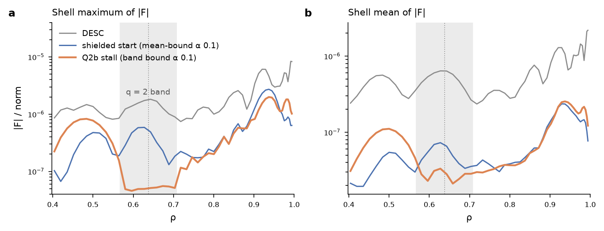
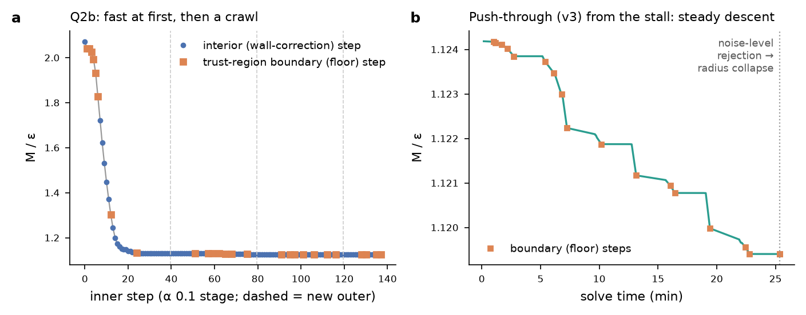
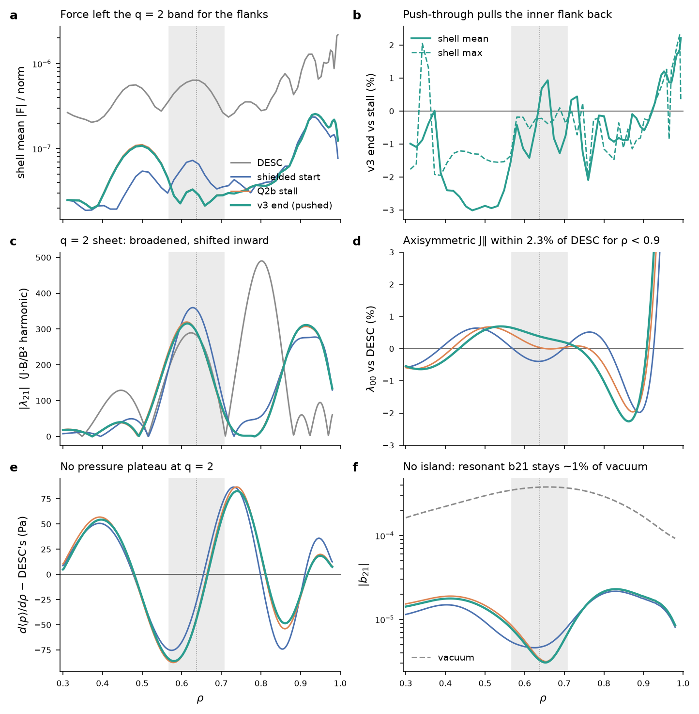
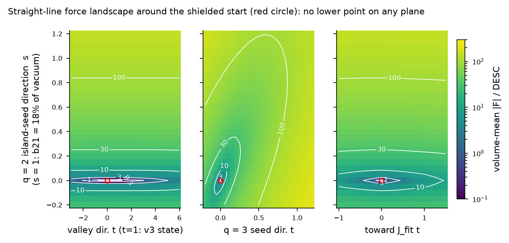
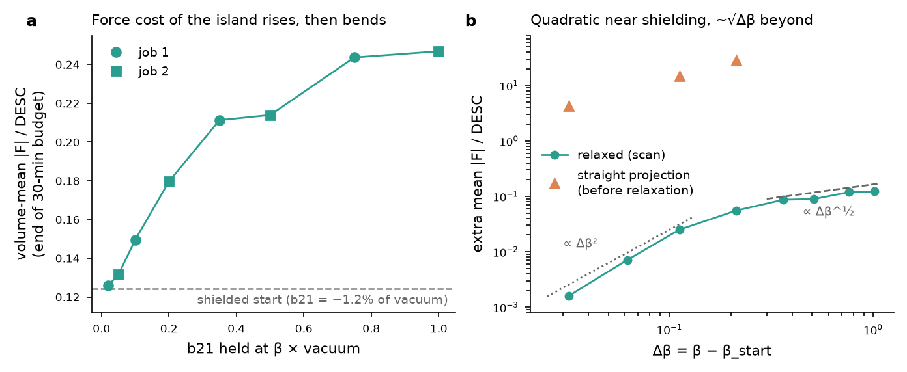
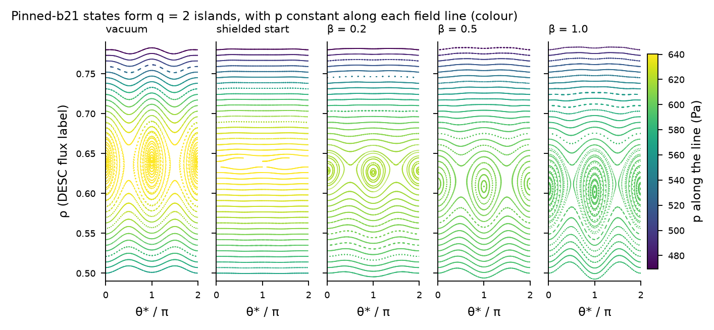
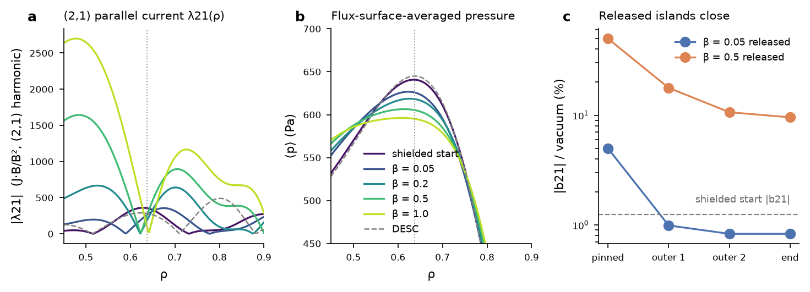

# Shielding or islands? The force landscape of a rippled tokamak in NEST

*Branch `ripple-landscape` (from `fixed-boundary`), November 2026. Data: `results/ripple_landscape/`
(manifest in its `README.md`). Figures: `figures/ripple_landscape/`. Job scripts: `scripts/modal_fixed/ripple/`.*

## Summary

We put a small resonant (2,1) ripple on the boundary of a tokamak equilibrium and asked what NEST does at the
q = 2 surface. NEST is an MHD equilibrium code that does not assume nested flux surfaces. Ideal MHD (and DESC,
which assumes nested surfaces) answers by *shielding*: a current sheet on the q = 2 surface cancels the resonant
field, and the surfaces stay intact. The alternative is *reconnection*: a magnetic island opens and the pressure
flattens across it.

Every NEST optimization started from DESC's state stayed shielded. The working hypothesis was that the shielded
state sits in a narrow valley, and that an island state might be a separate, possibly lower, basin that the
optimizer cannot reach. To test this we built a tool that holds the resonant field at a chosen fraction β of its
vacuum value and lets everything else relax. We then scanned β from 0.02 to 1.

At the resolution used (current basis 32/32/6, field grid a/60), the scan finds the following:

1. The constrained states are real islands. Their traced widths match the island width predicted from their own
   resonant field, and the pressure becomes constant along field lines (flattened) inside them.
2. The force error rises monotonically with island size. It goes from 0.124 × DESC's (shielded) to 0.247 × DESC's
   (full vacuum-size island). There is no barrier along the path and no second minimum.
3. When the constraint is removed, islands close again toward the shielded state.

So, at this resolution, shielding is the single valley floor, and islands with flattened pressure lie on its wall.
All force values are upper bounds from fixed-effort runs. The obvious open question is whether the
island–shielding gap changes with resolution.

Along the way we found and fixed a solver problem. At these force levels the merit function is noisy at the
relative 10⁻⁸ level, which made the trust-region solver stall. We also mapped the landscape along straight lines and
planes.

---

## 1. Background and setup

### 1.1 What NEST solves (fixed-boundary mode)

NEST represents the plasma current density **J** by the coefficients **u** of a current potential in a spectral
basis with radial, poloidal and toroidal resolution L, M, N (here 32, 32, 6, giving n_u = 7726 coefficients). The
net toroidal current I is held fixed, so **J** is a linear function of **u**.

The magnetic field is

  **B** = **B**_ext + **B**_ann[**J**].

**B**_ann[**J**] is the field of the plasma current, computed by an FFT-based solve on a cylindrical (R, φ, Z) grid
that encloses the plasma (the "annulus" grid). Its spacing is set by `--frac`: a/60 means a grid spacing of
a/60 ≈ 2 cm, i.e. 168 × 247 radial-by-vertical nodes on each of 25 toroidal planes (1.04 M nodes). **B**_ext is the
external (coil) field; Section 1.4 explains how we choose it.

The pressure is not an independent unknown. For each **J**, the pressure p (expanded in a basis with
n_p = 3655 coefficients) is chosen by least squares to best balance the magnetic force. In other words,
p* = argmin_p Σ_i w_i |**J** × **B** − ∇p|², and the force residual is

  **F** = **J** × **B** − ∇p*.

Here *i* runs over collocation points and w_i = dV_i / V are volume weights. The collocation points are a fixed
grid in DESC's flux coordinates (ρ, θ, ζ): 49 radii × 193 poloidal × 16 toroidal (half period, using stellarator
symmetry) = 151,312 points. Because the boundary is fixed, this grid never moves. ρ is DESC's radial label (square
root of the normalized toroidal flux). NEST's field need not have flux surfaces at constant ρ; ρ is just a
coordinate.

The force measure we bound is the **volume-mean force**

  M = Σ_i w_i |**F**_i| / norm.

Here "norm" is a fixed force scale. M_DESC is the same quantity for DESC's own equilibrium on the same grid
(4.9995 × 10⁻⁷ in code units). **All force values in this report are quoted as multiples of M_DESC.**

The optimization problem is

  minimize  ‖**J**(**u**) − **J**_fit‖² / rms(**J**_fit)²  subject to  M(**u**) ≤ ε = α M_DESC.

**J**_fit is DESC's current fitted into NEST's basis. In words: stay as close as possible to DESC's current while
having a force error at most α times DESC's. The constraint is handled by an augmented-Lagrangian outer loop with a
multiplier ν and a penalty κ (called `rho` in the logs; we write κ here to avoid a clash with the radius ρ). The
constraint value is reported as **M/ε**: M/ε < 1 means the bound is met. Each outer iteration minimizes a merit
function f(**u**) with a matrix-free trust-region Newton–Lanczos solver (GLTR). This is `nest/meanforce.py`
(solver) plus `nest/meanforce_fixed.py` (fixed-boundary model), driven by `scripts/meanforce/mf_fixed.py`.

Two properties of this model are used repeatedly:

- *The force is exactly quadratic along any straight line in u.* J is linear in u, B is affine in u, and the
  least-squares pressure is a fixed linear projection. So **F**(u₀ + t d) = **F**₀ + t **F**₁ + t² **F**₂ at every
  point, and a whole line or plane can be mapped from a handful of evaluations.
- *The pressure is eliminated.* There is no separate "flatten the pressure" degree of freedom. Whatever pressure
  best balances the current's force is chosen automatically at every state.

### 1.2 The test equilibrium ("candidate C" with a ripple)

The test equilibrium is a DSHAPE-like tokamak with these properties:

- Minor radius a = 1.198 m, major radius R₀ = 3.509 m, ⟨β⟩ = 0.021, NFP = 1, net current prescribed.
- The current profile was designed to be tearing-stable at q = 2. It is not tearing-stable at q = 3: the (3,1)
  surface has Δ′ > 0.
- The pressure is hollow, with dp/ds = 0 at the q = 2 surface, so there is no pressure-gradient drive exactly at
  the resonance.
- q = 2 lies at ρ = 0.6375, where |dι/dρ| = 0.234. q = 3 lies at ρ = 0.9131.
- The region ρ ≈ 0.45–0.62, just inside q = 2 where p′ > 0, is Mercier-unstable in DESC. This was checked directly
  and does not depend on the solver.

The boundary carries a resonant (m, n) = (2, 1) ripple of relative amplitude ξ/a = 10⁻³. DESC solved this
fixed-boundary equilibrium at L = M = 32, N = 4 (file
`desc_input/tokamak_boundary_perturbed/bp2/L32N4/tokamak_ripple_C_L32M32N4_x0.001.h5`). An L48 version is in
`bp2/L48N4/`. DESC assumes nested surfaces, so its answer is perfect shielding: zero resonant field on q = 2,
carried by a (2,1) current concentrated near q = 2.

### 1.3 How we measure islands

**The resonant field, b21.** Let δ**B** be the change of the field relative to DESC's. Define
b^ρ = δ**B**·∇ρ / (**B**_DESC·∇ζ) and take its (2,1) Fourier harmonic on the q = 2 surface, using straight-field-line
(PEST) angles θ* = θ + λ:

  b21 = ⟨ b^ρ e^{−i(2θ* + ζ)} ⟩.

This is a complex number. Its magnitude sets the island size. Its phase says whether the field opens an island in
the vacuum (driven) orientation or opposes it. The relevant reference values are:

- *Vacuum b21* is the resonant field with DESC's helical (shielding) current removed: |b21|_vac = 3.778 × 10⁻⁴.
  We quote |b21| as a percentage of this value. The vacuum drive points along the "island phase" (+90° in our
  convention).
- *Pendulum width.* A resonant field b21 on a surface with shear ι′ gives an island of full width
  w = 4 √(|b21| / (m |ι′|)) in ρ. For the vacuum field this is w_vac = 0.1136, about 10% of the minor radius.

**Poincaré traces.** We trace field lines of the NEST field in DESC's (ρ, θ*) coordinates for 300 toroidal
transits, starting 41 lines in ρ ∈ [0.50, 0.78]. The *radial spread* of a line is the range of ρ it visits; the
maximum over lines measures the island width directly.

**Pressure flattening.** We evaluate NEST's (least-squares) pressure along each traced line and record its
along-line spread. In an equilibrium with nested surfaces p is constant along lines trivially. In an island, p must
be constant along lines that wander radially, which means flattening. We report the along-line spread divided by
the drop in DESC's pressure over the same ρ range. This ratio is 1 if the pressure did not adapt to the island and 0
if it flattened perfectly. We also report the flux-surface-averaged pressure ⟨p⟩(ρ).

**Parallel current.** λ = **J**·**B**/B². Its (2,1) Fourier amplitude λ21(ρ) shows where the resonant (shielding)
current flows.

### 1.4 The external field (option A)

The DESC files are fixed-boundary and have no coils, so we must manufacture **B**_ext. We use

  **B**_ext = **B**_DESC − **B**_ann[**J**_fit]        ("option A", `--bext desc-fit`).

With this choice the field at **u** = **u**_fit is exactly DESC's field (to 10⁻¹⁷). The start is therefore exactly
DESC's shielded state, and the optimizer has to *choose* to reconnect.

A consequence is that the part of DESC's current that the basis cannot represent (J_DESC − J_fit) is
frozen into the "external" field (the fit error was 0.1% rms at basis 16/16/4 and is smaller at 32/32/6). At the start, J_fit has M = 6.86 M_DESC. Its force error is large because the
small fit error of J does not balance exactly; the optimizer removes this error in the first stages.

### 1.5 Resolution and its limits

The basis and grid were chosen by earlier convergence ladders:

- At 32/32/6 the mean force of a given state changes by at most about ±5% between a/60, a/80 and a/100.
- At 48/48/6, a/60 is not enough. The α = 0.1 state solved at a/60 evaluates to 0.102 / 0.142 / 0.171 M_DESC at
  a/60 / a/80 / a/100, because the optimizer had exploited the grid error. A working rule is h L / a ≲ 0.5, where
  h is the grid spacing.

Everything below is at **32/32/6, a/60, N_φ = 25**. The 48/48/6 state in the data folder is included for
completeness and carries this warning.

All runs used one GPU on Modal (H100; about 10 GB of device memory). One inner trust-region step takes 0.5–10 s.

---

## 2. The starting point: NEST's shielded state

Starting from J_fit, we ran an α continuation: α = 0.3 at a/40, re-seated at a/60, then α = 0.1. The α = 0.1
stage stalled at

- M = **0.1243 M_DESC** (M/ε = 1.24, so the α = 0.1 bound is *not* met), with ‖J − J_fit‖/rms = 1.2%.

We call this state the **shielded start** (`states/shielded_start_A60_a0.1.npz`). It is the starting point of
every experiment below. Its properties:

- *Shielded, slightly over-shielded.* |b21| = 1.24% of vacuum, in the anti-island phase (−90°). The pendulum width
  is 0.0126 and the largest traced radial spread is 0.0045, against 0.11 for the vacuum field (Fig. 6, second panel).
- *Shielding current.* λ21 peaks at 360 at ρ = 0.630 (DESC: 289), with half maximum over ρ ∈ [0.565, 0.685].
- *Residual force.* The residual force is not at q = 2. Per unit volume it is concentrated about 3.5× at
  ρ = 0.90–0.95, near the tearing-unstable q = 3 surface, and toward the edge (Fig. 1, blue curves).

The question for the rest of the report is whether this state is the only low-force state, or merely the one
nearest DESC.

---

## 3. Experiment 1: squeezing the force out of the q = 2 band

*Script `job_MQ2b.sh`; state `states/Q2b_stall_a0.1.npz`; log `runs/Q2b.log`.*

**Idea.** If shielding is expensive at q = 2, forcing the q = 2 region to be nearly force-free might make an island
the cheaper option there.

**Constraint.** We bounded a smooth maximum of the force inside the q = 2 band ρ ∈ [0.5675, 0.7075]: the p-norm
(Σ w |F|¹⁶ / Σ w)^{1/16} over the band, denoted "band p16". It was bounded at α times the shielded start's own band
p16, with α stepped 0.25 → 0.1. At the same time the whole-volume mean was held at or below the start's. Without
this second condition, force could simply move out of the band.

**Result.**

- α = 0.25 was met (mean 0.7% over).
- At α = 0.1 the run stalled with the band p16 at 0.103 × the start's. That is 0.032 × DESC's band p16, and the band
  maximum is 0.030 × DESC's.
- The whole-volume mean ended at 1.104 × the start's (0.141 M_DESC). The mean constraint was violated by 10%.

**Where did the force go?** Fig. 1 compares the shell-maximum and shell-mean force of DESC, the shielded start and
the stall. The q = 2 band was emptied almost uniformly, down to a floor of about 5 × 10⁻⁸. The displaced force went
to the inner flank (ρ ≈ 0.40–0.57) and to ρ > 0.95.

**No island appeared.** In the stall and in the pushed state below, b21 stayed at 0.9% of vacuum in the
anti-island phase. The profiles changed only slightly (Section 4.3). The optimizer met the band constraint by moving
force, not by reconnecting.



*Fig. 1. Force by flux shell for DESC (grey), the shielded start (blue) and the Q2b stall (orange), 32/32/6 a/60,
97 collocation radii. (a) Shell maximum of |F|. (b) Shell mean. Grey band: the bounded q = 2 band; dotted line:
q = 2.*

---

## 4. Experiment 2: why the solver stalled, and what it takes to push through

### 4.1 Anatomy of the stall

Fig. 2a shows every inner step of the Q2b α = 0.1 stage. Here M/ε is the composite constraint (band p16 and whole
mean, each against its bound). The first ~20 steps cut M/ε from 2.07 to 1.14. The next ~120 steps over three outer
iterations gained only 1.14 → 1.124.

The logs show this was a solver problem, not a floor:

- The steps that made progress were mostly trust-region *boundary* steps (orange squares).
- Between them the trust radius collapsed after a run of rejections.
- The rejected steps had predicted decreases comparable to the noise in f.

**The merit is noisy.** Re-evaluating f at the same point gives the same number, but f along a short line is rough.
It scatters by σ_f ≈ 5 × 10⁻⁸ to 10⁻⁷, i.e. 2–4 × 10⁻⁸ of f. The cause is the near-cancellation of **J** × **B**
and ∇p: at M ≈ 0.1 M_DESC the residual F is a small difference of two large terms, so round-off in F is a
noticeable fraction of F itself, and the merit inherits it. Once
the predicted decrease of a step falls below about 10 σ_f, the standard acceptance ratio (actual decrease)/(predicted
decrease) is dominated by noise. Steps are then rejected at random, each rejection shrinks the radius, smaller radii
predict smaller decreases, and the solver locks up.

### 4.2 Solver fixes (all in `nest/meanforce.py`, opt-in flags of `mf_fixed.py`)

| flag | what it does |
|---|---|
| `--f-noise auto` | measures σ_f at the start of every inner solve, by evaluating f at 6 random points 10⁻¹⁰ away (metric norm), where the smooth change is far below round-off |
| (with it) | noise-tolerant ratio r = (Δf + 2σ_f)/(pred + 2σ_f); accept if r > 0.1 |
| (with it) | a step whose predicted decrease is < 10 σ_f and that does not raise f by more than 4 σ_f is accepted with the radius kept |
| (with it) | the "decrease < ftol" stopping test is skipped (it fires on noise) |
| `--radius-by-delta` | after a rejection, the new radius is 0.25 × min(\|y\|, Δ) instead of a fixed fraction of Δ |
| `--no-share-stop` | do not stop an inner solve because a single step's share of the progress is small |
| `--geo-accel` | geodesic acceleration (second-order correction along curved floors); tested, no effect on short floor steps |

A first version re-used a stale σ_f and accepted noise-level steps unconditionally; it let f run away to 2.8 × 10⁵.
That is fixed: σ_f is re-measured every inner solve, and the f-increase test is enforced.

### 4.3 Push-through from the stall

With the merit frozen at the stall's multiplier and penalty (ν = 13.94, κ = 100) and the fixes on, one long inner
solve from the stall (Fig. 2b; `job_PTA.sh` v3, `states/pushthrough_v3_end.npz`) reduced M/ε from 1.1242 to 1.1194
in about 25 minutes. The rate was steady, not decaying. About 85% of the decrease came from boundary ("floor")
steps. The interpretation is that the optimizer is moving along a long, curved, gently sloping valley floor.

The pushed state is physically almost identical to the stall (Fig. 3):

- The force moved by only a few percent per shell; the inner flank was slowly pulled back.
- The q = 2 sheet λ21 is broadened and shifted slightly inward relative to DESC.
- The axisymmetric parallel current is within 2.3% of DESC's for ρ < 0.9.
- d⟨p⟩/dρ shows no plateau at q = 2.
- |b21| stays at about 1% of vacuum.

**Conclusion of Experiments 1–2.** Tightening the force at q = 2 moves the state *along* the shielded valley. The
optimizer has no incentive in these constraints to reconnect, and the valley floor is long and nearly flat.



*Fig. 2. (a) Composite constraint M/ε (band p16 and whole mean against their bounds) at every inner step of the Q2b
α = 0.1 stage; squares are trust-region boundary steps; dashed lines mark new outer iterations. (b) Push-through
(v3): one inner solve from the stall with the noise-aware trust region, against wall time; squares are boundary
steps.*



*Fig. 3. Profiles of DESC (grey), the shielded start (blue), the Q2b stall (orange) and the pushed state (green).
(a) Shell-mean |F|. (b) Change of the pushed state versus the stall, in % (shell mean and shell max). (c) |λ21(ρ)|.
(d) Axisymmetric λ00 relative to DESC. (e) d⟨p⟩/dρ minus DESC's. (f) |b21(ρ)|, with the vacuum value dashed. Grey
band: q = 2 band.*

---

## 5. Experiment 3: the landscape along straight lines and planes

*Script `scripts/meanforce/plane_map.py` via `mf_fixed.py --plane`; data `diagnostics/pm_ev60*`.*

Because the force is exactly quadratic in u, six evaluations give the force at every point of a plane
u = u₀ + s d₁ + t d₂, and a seventh checks
the fit (relative fit errors ≤ 8.3 × 10⁻¹⁰). We used u₀ = the shielded start and
d₁ = (q = 2 island seed − J_fit). The **island seed** (`states/seed_q2_w0.07.npz`, made by
`scripts/meanforce/island_seed.py`) is J_fit with its helical current removed within |ρ − 0.6375| ≤ 0.07, so that
s = 1 adds 18% of the vacuum b21 in the island phase. The second direction d₂ was one of three choices:

1. along the valley (towards the pushed state);
2. towards a q = 3 seed;
3. back towards J_fit.

**Result (Fig. 4).** The shielded start is the minimum on all three planes. Along the island direction the mean
force rises steeply: 23.8 M_DESC at s = −0.2 and 119 M_DESC at s = 1. This is about 6.6 M_DESC per 1% of vacuum
b21.

That cost is not the cost of an island; it is the cost of a *straight* move. Removing the shielding current without
letting anything else adjust leaves huge unbalanced forces. Straight lines and planes therefore *overestimate*
barriers. To learn the true cost of an island, everything except the island must be allowed to relax. This is the
motivation for the β scan.



*Fig. 4. Exact volume-mean force (colour, log scale, in M_DESC) on three planes through the shielded start (red
circle). Vertical axis: the q = 2 island-seed direction (s = 1: b21 = 18% of vacuum). Horizontal axes: (left) the
valley direction (t = 1: pushed state); (middle) the q = 3 seed direction; (right) towards J_fit.*

---

## 6. Experiment 4: the β scan (island size held fixed, everything else relaxed)

*Scripts `job_bs1.sh`, `job_bs2.sh`; states `states/beta_*.npz`; logs `runs/bs*.log`.*

### 6.1 Method: pinning the resonant field

b21 as defined in Section 1.3 is a *linear* function of u. The only difference from DESC's field is
**B**_ann[**J**(u) − **J**_fit], which is linear in u; the denominator **B**_DESC·∇ζ is fixed. We evaluate it on the
two collocation shells that bracket ρ = 0.6375 and interpolate (`nest/meanforce_fixed.resonant_b_fn`; it agrees with
the independent trace-based diagnostic `start_check_bext.py` to 1.2%).

Holding b21 at a prescribed complex value,

  b21(u) = β |b21|_vac e^{iφ_island},

is then two linear equality constraints, the real and imaginary parts. The solver enforces them exactly by
restricting every trial step to the constraint's null space (`LinearConstraints(..., affine=...)`); the residual
violation is < 3 × 10⁻¹⁹. φ_island is the phase of the all-helical-current-removed seed, which is +90°. With the island size
pinned, the optimizer minimizes the same objective under the same mean bound α = 0.1. Everything else is free:
shielding currents elsewhere, the pressure (through J), and the island's internal structure.

Each run used:

1. start: the shielded start, projected onto the constraint (the smallest change of u, in the solver's metric,
   that satisfies the pin);
2. `--alphas 0.1 --max-outer 12 --stage-flat 0.02 --f-noise auto --radius-by-delta --no-share-stop`;
3. an equal **30-minute wall-time budget** per β on an H100.

No run met α = 0.1; the shielded start does not meet it either. The bound therefore acts as a "push the force down
as far as you can" target. The end values are what a fixed effort achieved, so **they are upper bounds** on the
minimum force at each β. In all runs the penalty κ climbed to 10⁷–10⁸, and the least-squares multiplier estimate
swung erratically. This is the signature of a constraint that stays violated, and it limits progress per step.

### 6.2 Result

**Table 1.** β scan at 32/32/6, a/60. "Projected" is the force right after projecting the shielded start onto the
pin (the straight-move cost); "relaxed" is the end of the 30-minute run. Widths are in ρ.

| β | \|b21\| / vac | pendulum width | Poincaré max spread | projected M / M_DESC | relaxed M / M_DESC | \|Δu\| / \|u_start\| |
|---|---|---|---|---|---|---|
| start | 1.24% (−90°) | 0.0126 | 0.0045 | — | 0.124 | 0 |
| 0.02 | 2% | — | — | 4.35 | 0.126 | 0.040 |
| 0.05 | 5% | 0.0254 | 0.0166 | 8.36 | 0.132 | 0.056 |
| 0.1 | 10% | — | — | 15.0 | 0.150 | 0.059 |
| 0.2 | 20% | 0.0507 | 0.0495 | 28.4 | 0.180 | 0.099 |
| 0.35 | 35% | — | — | 48.4 | 0.211 | 0.145 |
| 0.5 | 50% | 0.0801 | 0.0755 | 68.5 | 0.214 | 0.202 |
| 0.75 | 75% | — | — | 101.9 | 0.244 | 0.231 |
| 1.0 | 100% | 0.1134 | 0.1067 | 135.3 | 0.247 | 0.279 |
| vacuum field | 100% | 0.1137 | 0.1073 | — | — | — |

(Widths were computed for the β values shown; the dashes were not diagnosed.)

Three observations (Fig. 5):

1. **Relaxation removes 97–99.8% of the straight-move cost.** A vacuum-size island costs 135 M_DESC as a straight
   move but 0.247 M_DESC after relaxation. That is about twice the shielded state's force, not a thousand times.
2. **The cost rises monotonically with β, with no barrier.** Near the floor the extra force grows like (Δβ)², as
   expected near a constrained minimum where the first-order term vanishes. Beyond β ≈ 0.1 it grows much more slowly,
   roughly like √Δβ for β = 0.35–1. One plausible reading involves the mean of |F|, an L1-type measure: once the
   island's force perturbation dominates the residual pointwise, M grows with the volume of the affected region. That
   volume scales with the island width, which is ∝ √b21. Part of the flattening at β = 0.35–0.5 is also likely
   effort-limited, since all runs had the same budget.
3. **Large steps.** In the relaxed runs the accepted steps were long: trust radii of 10⁵–10⁶ in the scaled variables,
   with ratios 0.36–0.68 on boundary steps. This indicates a curved floor that the quadratic model follows only
   approximately.



*Fig. 5. (a) Relaxed volume-mean force against the pinned b21 (β × vacuum, island phase), at the end of equal
30-minute runs (two jobs). Dashed: shielded start. (b) Extra force over the start against Δβ = β − β_start (log–log),
with the straight-projection cost (triangles) for β = 0.02, 0.1, 0.2. Guides: ∝ Δβ² and ∝ Δβ^{1/2}.*

---

## 7. Experiment 5: are the pinned states real islands with flattened pressure?

*Script `job_bd.sh` (first part); data `diagnostics/bd_m2*`, `diagnostics/bd_dist.txt`.*

A pinned b21 could, in principle, be satisfied by a field that is resonant only at the two collocation shells,
without forming an island. The diagnostics rule this out.

**Islands (Fig. 6).** Poincaré sections of the pinned states show (2,1) islands centred at q = 2. Their traced
width tracks the pendulum width computed from each state's own b21 (Table 1): 0.050 against 0.051 at β = 0.2, and
0.107 against 0.113 at β = 1. At β = 1 the island looks like the vacuum island. Its O-point has moved inward, to
ρ ≈ 0.61 at β = 1.

**Pressure flattens.** Colour in Fig. 6 is NEST's pressure along each line, and it is constant along lines inside
the islands. Quantitatively:

- The median along-line spread divided by DESC's drop over the same ρ range is 0.01–0.07 for the β states. For the
  vacuum field with DESC's pressure it is 1.00.
- ⟨p⟩ at q = 2 falls from 641 Pa (start) to 626 / 618 / 605 / 595 Pa at β = 0.05 / 0.2 / 0.5 / 1.
- The hollow peak is cut off and spread over the island (Fig. 7b).

Note that NEST does this without any pressure degree of freedom of its own. The least-squares pressure follows
the field lines.

**The resonant current leaves the resonant surface (Fig. 7a).** λ21 at ρ = 0.6375 falls from 354 (start) to 78
(β = 1). The resonant current reappears on both sides:

- an outer peak at ρ ≈ 0.70–0.73, rising to 1166 at β = 1;
- a larger inner peak at ρ ≈ 0.48, rising to 1644 at β = 0.5 and 2701 at β = 1.

The inner peak lies well inward of the island's inner separatrix (about ρ = 0.55 at β = 1), in the
Mercier-unstable region where p′ > 0. We do not yet know whether it is where the extra force sits. A per-shell force map of the
β = 1 state is the obvious next diagnostic.

**One continuous path.** Successive β states differ by small, nearly collinear displacements (`bd_dist.txt`):

- The cosine between displacements of consecutive states from the start is 0.90–0.99.
- The distance from the start grows from 4% (β = 0.02) to 28% (β = 1) of |u_start|.
- The direction turns gradually: cos(d₀.₀₂, d₁.₀) = 0.63.

There is no jump that would indicate a switch between basins.



*Fig. 6. Poincaré sections in DESC (ρ, θ*) coordinates (300 transits, 41 lines), coloured by NEST's pressure along
each line. Left to right: the vacuum field (DESC with its helical current removed, carrying DESC's p), the shielded
start, and the pinned states β = 0.2, 0.5, 1.0.*



*Fig. 7. (a) |λ21(ρ)|, the (2,1) harmonic of J·B/B², for DESC (dashed), the shielded start and the pinned states.
(b) Flux-surface-averaged pressure ⟨p⟩(ρ). Dotted line: q = 2. (c) Release tests: |b21| as a percentage of vacuum
when the pin is removed from the β = 0.05 and β = 0.5 states (pinned value, after outer iterations 1 and 2, and at
the 20-minute budget). Dashed: the shielded start's |b21|.*

---

## 8. Experiment 6: release tests (do islands stay open?)

*Script `job_bd.sh` (second part); states `states/release_from_beta*.npz`; logs `runs/rel*.log`,
`runs/bd_b21.log`.*

If an island state were a separate local minimum, removing the pin would leave it in place. We removed the pin from
the β = 0.05 and β = 0.5 states. We also reset the multiplier and penalty, so the solve was fresh. Each state was
then re-optimized under the same α = 0.1 mean bound for 20 minutes.

**Table 2.** Release tests.

| released from | \|b21\| / vac: pinned → outer 1 → outer 2 → end | M / M_DESC: pinned → end |
|---|---|---|
| β = 0.05 | 5% → 0.99% → 0.83% → 0.83% | 0.131 → **0.1228** |
| β = 0.5 | 50% → 17.8% → 10.6% → 9.6% | 0.213 → 0.151 (still decreasing) |

Both islands close (Fig. 7c):

- The β = 0.05 state falls back to a nearly shielded state, *below* the shielded start's force (0.1228 against
  0.1243). It keeps a residual 0.8% b21 in the island phase. This is a slightly better point on the same valley
  floor, which the original continuation had not reached.
- The β = 0.5 state was still closing when the budget ran out. Its end point (b21 9.6%, M = 0.151) lies on the β
  scan curve: the pinned β = 0.1 state has M = 0.150. The released state rolled down the same wall that the scan
  climbed.

---

## 9. Interpretation

At 32/32/6, a/60, with the volume-mean force as the measure:

1. **One valley.** The shielded state is the floor. The island states lie on a monotone ramp up its wall. There is
   no barrier along the constrained path and no second basin: released islands close.
2. **Islands are real but cost force.** A vacuum-size island with a flattened pressure is a legitimate NEST state.
   Its force is about 2× the shielded force (0.247 against 0.124 M_DESC), and both are upper bounds from equal-effort
   runs. Within this model the optimizer has no incentive to reconnect, which explains why no unconstrained run ever
   did.
3. **The narrow-valley picture was half right.** The valley is narrow in the sense that straight moves away from it
   cost 100× more than the force inside it. This is why unconstrained optimizers only slide along it (Experiments
   1–2). But the island states are not in a hidden valley behind a ridge. They are reachable by a gentle path once
   the right constraint (fixed b21) holds the island open.
4. **What this does not say.** It does not say that ideal shielding is "right" and reconnection "wrong" for this
   equilibrium in general. The comparison is between finite-resolution approximations. The shielding current is a
   sheet that the smooth basis smears over about 0.1 in ρ. The island states, in turn, carry current concentrations
   at their edges (Fig. 7a) that the basis also smears. How the two costs scale with resolution is the key unknown.

## 10. Caveats

- **Effort-limited.** Every relaxed value is the end of a fixed 20–30 minute budget, not a converged minimum. The
  release test shows that even the shielded start was not fully converged (0.1228 < 0.1243).
- **One resolution.** 32/32/6, a/60. Convergence in the field grid is about ±5% at this basis. Convergence in the
  basis (L, M) has not been tested for these island states.
- **One force measure.** All bounds use the volume mean of |F| (α = 0.1, never met). A maximum-type measure would
  weigh localized island-edge forces differently.
- **Solver behaviour.** In the mean-bound runs the penalty κ escalates to 10⁷–10⁸ and the multiplier estimate is
  erratic. This probably costs progress per step but should not change the ordering of states.
- **Option A.** The basis-unrepresentable part of DESC's current (≤ 0.1% rms) is frozen into B_ext with the
  vacuum drive's phase, so it adds a small (2,1) drive.

## 11. Suggested next steps

1. **Resolution test of the island–shielding gap.** Repeat the pin at β ≈ 0 (the shielded state), 0.5 and 1.0 at
   48/48/6 with a/100 or finer (the L48 grid rule), or at a/80 for 32/32/6. Use equal *iteration* budgets on an
   A100-40GB, which is enough memory and cheaper than an H100. If the gap shrinks with resolution, the shielded
   valley may be a finite-resolution effect.
2. **Per-shell force maps of the β = 1 state.** Find where the extra 0.12 M_DESC sits: island separatrix, the inner
   λ21 peak at ρ ≈ 0.48, or the q = 3 region.
3. **A longer release of β = 0.5**, to see whether it closes fully or stops at a small residual island.
4. **A reduced model.** The force is exactly quadratic in u, so the landscape restricted to a resonance subspace
   (shielding currents near q = 2, the island direction, the edge currents) can be computed exactly and minimized
   cheaply.
5. **Max-type bounds** with the same pin, to weigh localized forces. For example, a p16 norm of |F|/g(ρ) with g the
   start's shell-max profile.
6. **Solver.** Tame the κ escalation in mean-bound runs. Test geodesic acceleration on the long curved floor steps of
   the β runs; on the short floor steps of the push-through it made no difference.

---

## Appendix A. Glossary

| symbol | meaning |
|---|---|
| ρ | DESC radial label (√ normalized toroidal flux); a fixed coordinate, not a NEST flux surface |
| θ*, ζ | straight-field-line (PEST) poloidal angle of DESC, toroidal angle |
| u | NEST current-potential coefficients (the unknowns) |
| J_fit | DESC's current fitted into NEST's basis |
| B_ann[J] | field of current J computed on the annulus grid |
| F | force residual J × B − ∇p* with p* the least-squares pressure |
| M | volume mean of \|F\| (normalized); M_DESC: the same for DESC's equilibrium |
| α, ε | bound M ≤ ε = α M_DESC |
| M/ε | constraint value (< 1 met) |
| ν, κ | augmented-Lagrangian multiplier and penalty (`nu`, `rho` in logs and npz files) |
| band p16 | (Σ_band w \|F\|¹⁶ / Σ_band w)^{1/16} over ρ ∈ [0.5675, 0.7075]; a smooth maximum |
| b21 | (2,1) harmonic of δB·∇ρ / B_DESC·∇ζ on q = 2; vacuum value 3.778 × 10⁻⁴ |
| β | pinned \|b21\| as a fraction of vacuum, in the island phase |
| λ21 | (2,1) harmonic of J·B/B² |
| pendulum width | 4 √(\|b21\| / (m \|ι′\|)), the island width implied by b21 |
| σ_f | noise level of the merit function at a point |

## Appendix B. Reproducing the results

Each experiment corresponds to one job script in `scripts/modal_fixed/ripple/` (run under `rung_run.sh` on a GPU
container that has DESC and NEST unpacked; see `scripts/modal_fixed/` for the image). In dependency order:

| step | script | produces |
|---|---|---|
| α continuation at a/60 | `job_A60_cont.sh` (from `job_A32_a03.sh`'s a/40 state) | shielded start |
| island seeds, band references | `job_pre32.sh` | `seed_*` states |
| band-max runs | `job_MQ2.sh`, `job_MQ2b.sh`; evaluation `job_dqb.sh` | Q2, Q2b states |
| push-through | `job_PTA.sh` (arm A, v3), `job_PTB.sh` (arm B, geodesic acceleration) | pushed state |
| profiles | `job_pv.sh` | `pv_*.json` |
| plane maps and pin smoke test | `job_pm.sh` | `pm_*` |
| β scan | `job_bs1.sh` (β 0.02, 0.1, 0.35, 0.75), `job_bs2.sh` (0.05, 0.2, 0.5, 1.0) | `beta_*` states |
| diagnostics and release tests | `job_bd.sh` | `bd_*`, `release_*` |

A single β run, written out (paths relative to the repository root):

```bash
python scripts/meanforce/mf_fixed.py \
    --eq desc_input/tokamak_boundary_perturbed/bp2/L32N4/tokamak_ripple_C_L32M32N4_x0.001.h5 \
    --bext desc-fit --LMN 32 32 6 --frac 60 --N-phi 25 --alphas 0.1 \
    --start results/ripple_landscape/states/shielded_start_A60_a0.1.npz \
    --pin-b21 0.5 --b21-phase-state results/ripple_landscape/states/seed_all_helical.npz \
    --max-outer 12 --stage-flat 0.02 --f-noise auto --radius-by-delta --no-share-stop \
    --time-budget 1800 --out out/bs0.5
```

A time-budget stop saves `<out>_budget.npz`, not `<out>_a0.1.npz`.

## Appendix C. Code added on this branch

- `nest/meanforce.py`:
  - noise-aware trust region (`f_sigma`, `estimate_f_noise`, automatic re-estimation every inner solve, relaxed
    ratio and noise-level acceptance);
  - `radius_by_delta` shrink rule; `no_share_stop`;
  - geodesic acceleration (`Solver._geodesic`, `geo_accel`).
- `nest/meanforce_fixed.py`:
  - `resonant_b_fn` (linear b_mk functional);
  - affine equality constraints in `LinearConstraints(..., affine=[(name, fn, target)])`, with joint restore and a
    violation report.
- `scripts/meanforce/mf_fixed.py`:
  - flags `--pin-b21`, `--b21-mk`, `--b21-vac`, `--b21-phase-state`, `--b21-report`, `--plane`;
  - solver flags `--f-noise`, `--radius-by-delta`, `--no-share-stop`, `--keep-start-mult`, `--geo-accel`
    (`--accel-*`).
- `scripts/meanforce/plane_map.py` (exact quadratic plane maps).
- `scripts/meanforce/island_seed.py`, `start_check_bext.py` (island, Poincaré, pressure and J∥ diagnostics),
  `line_anatomy.py`, `nphi_gate.py`.
- DESC inputs: `desc_input/tokamak_boundary_perturbed/` (generation scripts, the bp2 ripple family at L24/L32/L48).

The test suite was not re-run for these changes; the new code paths are opt-in flags.

---

## Addendum (later on 2026-11-12): resolution, characterization, energy

The resolution test proposed in Section 11 was run. Full numbers are in `results/ripple_landscape/resolution/README.md`;
the overview is `docs/handoff_ripple_landscape_2026-11-12.md`. In brief (M / M_DESC):

- **Second rung.** At 40/40/6 (field grid a/80) both the shielded and the β = 1 states reach the α = 0.1 bound. Pushed
  toward α = 0.05 and evaluated on a common a/120, 120-radius grid, the island–shielding gap is 0.015–0.019. That is
  about 0.2 × the 32/32/6 gap (0.081), and it is unchanged by refining the field grid (a/100) or the radial
  collocation (98 radii). With two rungs, this supports model C (the gap closing with resolution) but does not
  establish it.
- **Where the island costs force.** About 70% of the island state's extra force sits around q = 3 (ρ 0.86–0.94), not
  at q = 2. q = 3 stays shielded in both states. The island state also shifts ι(s) globally (up to ±1.6e-2) and
  displaces the core helically. Figures: `figures/ripple_landscape/compare/`.
- **Energy.** Island states have lower magnetic energy (−126 J of 1.93 MJ at 40/40/6). Their thermal energy, from
  NEST's least-squares pressure, is higher, and their force error is higher. Helicity changes by a fraction of 3e-3,
  which is at the level of the gauge ambiguity set by B·n ≠ 0 on the boundary.
