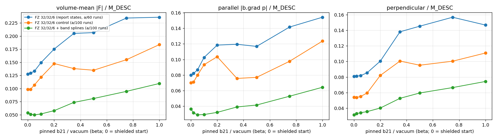
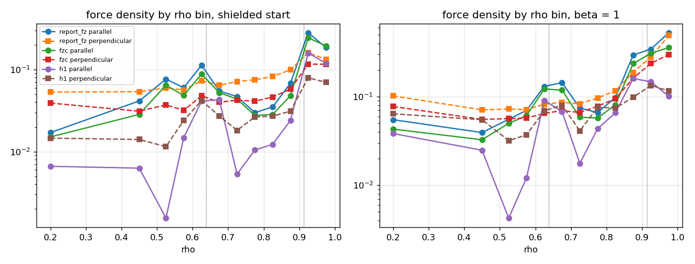

# Ripple landscape with B-splines: FZ vs FZ + band-localized splines

*Branch `ripple-spline` (from `ripple-landscape`), 2026-11-12/13. Plan, gates and run log: `docs/ripple_spline_plan.md`.
Data: `results/ripple_spline/` (summary tables `summary.md/json`, states, run records with live logs, common-grid
evaluations, Phase 0). Figures: `figures/ripple_spline/`. Job scripts: `scripts/ripple_spline/`. Runs on Stellar-AI
(`/scratch/gpfs/EKOLEMEN/lk1158/NEST_rspl/out/rs/`).*

## Summary

We repeated the experiments of `docs/ripple_landscape_report.md` with B-spline radial representations of the current
potential T and the pressure p. The experiments are the shielded start, the beta scan with b21 pinned in the island
phase, the release tests, and the island and pressure diagnostics. The question was whether radial refinement at the
2/1 island changes the force landscape and lowers the b.grad p part of the force error.

1. **Pure cubic B-splines fail at practical sizes.** With knots at 0.6x or 0.45x Fourier-Zernike's zero spacing plus
   dense bands at q = 2 and q = 3 (n_u 24k / 31k), the shielded-start continuations stalled at 0.50 / 0.38 M_DESC,
   against 0.098 for FZ on the same grid. The excess is in the smooth core (rho < 0.5), where the perpendicular force is
   15-30x FZ's. At M ~ 0.1 M_DESC force balance resolves J to ~1e-7 of |J|. A cubic-spline fit leaves a knot-scale
   oscillating error whose curl no pressure balances; FZ's spectral error is smooth. Truncation and the axis cap were
   ruled out.
2. **Hybrid basis: FZ 32/32/6 plus cubic B-splines confined to the island bands** (q = 2: rho 0.45-0.76, spacing 0.01;
   q = 3: 0.86-0.95, spacing 0.015; |m| <= 16, n <= 6). Each spline and its first two derivatives vanish at the band
   edges. The FZ part therefore keeps its spectral accuracy, axis regularity and edge refinement, and the boundary
   conditions are FZ's. J_fit and the p fit are FZ's exactly. n_u 21056 (FZ 7726), n_p 10320 (FZ 3655).
3. **The hybrid halves the force at every island size and halves b.grad p.** Common grid (a/120), equal iteration
   counts (12 outer iterations, ~480 trials per pinned run), same start, same solver:

   | | start | beta 0.05 | 0.1 | 0.2 | 0.5 | 1.0 |
   |---|---|---|---|---|---|---|
   | report (FZ, a/60 runs) M | 0.128 | 0.133 | 0.150 | 0.175 | 0.207 | 0.236 |
   | FZ control (a/100 runs) M | 0.098 | 0.107 | 0.122 | 0.148 | 0.135 | 0.184 |
   | **hybrid** (a/100 runs) M | **0.054** | **0.050** | **0.051** | **0.058** | **0.081** | **0.110** |
   | FZ control parallel / perp | 0.070 / 0.054 | 0.080 / 0.055 | 0.093 / 0.059 | 0.104 / 0.082 | 0.077 / 0.095 | 0.124 / 0.111 |
   | **hybrid** parallel / perp | 0.036 / 0.031 | 0.029 / 0.034 | 0.029 / 0.036 | 0.032 / 0.040 | 0.041 / 0.059 | 0.064 / 0.074 |

   (M, parallel |b.F| = |b.grad p| and perpendicular force: volume means in M_DESC.)
4. **b.grad p is set by J, not by p.** At fixed J, extra pressure freedom (pure-spline p or the hybrid's band splines)
   lowers only the perpendicular part; the parallel part stays at 0.0803 -> 0.0803 at the shielded start. When T and p
   are refined together the parallel force halves (0.070 -> 0.036 at the start; 0.124 -> 0.064 at beta = 1). The
   rest of it sits at q = 3 (rho 0.9-0.95), at the edge, and in the q = 2 band (rho 0.6-0.7) (Fig. 2).
5. **The landscape changes shape at its bottom.** FZ (report and control): shielding is the single valley floor,
   islands climb a monotone wall, and released islands close (beta 0.05: b21 5% -> 0.65% of vacuum). Hybrid: the
   bottom is flat from the over-shielded start (b21 1.4%, anti-island phase) to small island-phase states. The beta =
   0.02-0.1 states (0.050-0.051) lie *below* the shielded start (0.054). The release from beta = 0.05 stays open at
   b21 4.4% (island phase) and goes lower still (0.049). Large islands still cost force (beta = 1: +0.056 over the
   start; FZ control +0.086). Released large islands close at the same rate in both bases (beta 0.5: 50% -> 19-21%
   in ~120-220 trials).



*Fig. 1. Common-grid (a/120) volume-mean force, parallel |b.grad p| and perpendicular force against the pinned b21 for
the report's FZ states (a/60 runs), the FZ control (a/100 runs) and the hybrid (a/100 runs); beta = 0 is each
shielded start.*



*Fig. 2. Force density by rho bin (bin mean / M_DESC, log scale), parallel (solid) and perpendicular (dashed), for the
shielded starts (left) and the beta = 1 states (right). Dotted: q = 2 and q = 3.*

## 1. Setup

As the report, except as stated. The equilibrium is candidate C ripple (`bp2/L32N4/tokamak_ripple_C_L32M32N4_x0.001.h5`).
The external field is option A (B_ext = B_DESC - B_ann[J_fit]). The force bound is on the volume mean, with N_phi 25
and the noise-aware trust region (`--f-noise auto --radius-by-delta --no-share-stop`).

- **Lanczos cap 1500** (`--cg 1500`). The default 400 turned every cap hit into a 10-16 min metric rebuild at
  n_u > 20k; rebuilds took 75-90% of the run time.
- **Field grid a/100** for every new run, since the spline bands are finer than a/60 resolves. Every state was
  re-evaluated on one common grid: field a/120, with radial collocation by composite Gauss over the hybrid's
  breakpoints.
- **FZ control (`fzc`).** The report's basis run through exactly the hybrid's pipeline, grid and solver. Differences
  fzc vs h1 come from the basis; fzc vs report come from the grid (a/60 -> a/100: -20 to -35% at every beta) and the
  solver settings.
- **Common start.** Both start from the report's FZ shielded start, which embeds exactly in the hybrid. At a/100 both
  met alpha = 0.1 within minutes, unlike the report's run at a/60. The targets were lowered so the bound stays unmet,
  as in the report: the shielded start is the continuation 0.1 -> 0.05 (0.05 not met), and the beta and release runs
  use alpha = 0.02.
- **Equal iteration counts.** Hybrid trials are slower. Its beta runs were extended from their end states
  (`p2_beta_ext.sh`) to the FZ runs' stopping rule of 12 outer iterations: 470-503 trials against FZ's 479-480, over
  2.5-4 h against ~75 min.

## 2. Results

### 2.1 Shielded start

| | M / M_DESC | parallel / perp | b21 (% vac, phase) | abs(J - J_fit) / rms |
|---|---|---|---|---|
| report (FZ, a/60) | 0.128 | 0.080 / 0.081 | 1.23, -90 deg | 0.012 |
| FZ control (a/100) | 0.098 | 0.070 / 0.054 | 0.59, -90 deg | 0.026 |
| hybrid (a/100) | 0.054 | 0.036 / 0.031 | 1.43, -90 deg | 0.015 |
| pure splines s1 / s2 | 0.50 / 0.38 (run grid) | - | - | 0.068 / 0.041 |

### 2.2 Beta scan and releases (common grid)

Full table: `results/ripple_spline/summary.md`.

| beta | FZ control M | hybrid M | hybrid b21 % |
|---|---|---|---|
| start | 0.0983 | 0.0537 | 1.43 (anti-island) |
| 0.02 | 0.0985 | 0.0508 | 2 |
| 0.05 | 0.1068 | 0.0498 | 5 |
| 0.1 | 0.1215 | 0.0514 | 10 |
| 0.2 | 0.1477 | 0.0578 | 20 |
| 0.35 | 0.1380 | 0.0735 | 35 |
| 0.5 | 0.1349 | 0.0809 | 50 |
| 0.75 | 0.1550 | 0.0946 | 75 |
| 1.0 | 0.1838 | 0.1096 | 100 |
| release from 0.05 | 0.0974 (b21 0.65%) | 0.0493 (b21 4.38%) | |
| release from 0.5 | 0.1070 (b21 20.9%) | 0.0541 (b21 19.1%) | |

The FZ control's dip at beta 0.35-0.5 is effort-limited; the report's curve flattened there too. The hybrid curve is
monotone from beta = 0.05 on.

### 2.3 Islands and pressure (run-grid diagnostics, start_check_bext)

All pinned states are real (2,1) islands in both bases: traced width ~ pendulum width of the state's own b21.

| beta | pendulum w | traced: FZ ctl / hybrid | min p'/p'_DESC near q = 2: FZ ctl / hybrid |
|---|---|---|---|
| 0.05 | 0.025 | 0.020 / 0.017 | 0.019 / 0.044 |
| 0.2 | 0.051 | 0.054 / 0.049 | 0.021 / 0.095 |
| 0.5 | 0.080 | 0.079 / 0.078 | 0.001 / 0.120 |
| 1.0 | 0.114 | 0.101 / 0.096 | 0.003 / 0.017 |

In both bases the pressure flattens inside the islands. The hybrid keeps a slightly larger residual p' at the
resonance (0.04-0.12 of DESC's, against 0.001-0.02 for FZ). Its band splines can carry a sharper p profile across the
island, so its p is not forced flat to the same degree while its force is lower.

### 2.4 Fixed-J tests (Phase 0)

The least-squares p of the report's FZ states was re-solved in other p spaces.

- **Pure spline p:** the perpendicular force rose to 4-40 M_DESC. The FZ states balance J x B against an FZ p to
  ~1e-7, which cubic splines cannot reproduce.
- **Hybrid p** (which contains FZ's): M fell 6-9% (start 0.128 -> 0.120, beta 1 0.255 -> 0.237). The change was all
  perpendicular; the parallel part was unchanged (0.0803 -> 0.0803).

## 3. Interpretation

- **Most of the remaining force was a representation limit near the resonant surfaces.** Refining the radial
  representation in the q = 2 and q = 3 bands lowers the whole landscape by ~45%, and b.grad p by the same factor, at
  equal iteration counts. It is not a property of the equilibrium.
- **Lowering b.grad p needs J and p refined together.** Pressure freedom alone cannot do it: the parallel force at
  fixed J is fixed by J and the field-line geometry. With the joint refinement, the parallel share of the error falls
  from ~56% (FZ control, start) to ~54%; it falls in absolute terms by 2x. What is left is concentrated at q = 3 and
  the edge, the next places to refine.
- **The report's "one valley, shielding at the floor" holds for FZ and for large islands, but not at the bottom of the
  refined landscape.** With the hybrid, the floor is flat between the over-shielded state and small island-phase
  states, roughly b21 <= 5-10% of vacuum (island widths up to ~0.03 in rho). Small islands are at least as cheap as
  shielding there, and a released small island does not close within the release budget. This matches the
  hand-off's model C: shielded and reconnected states move closer as the representation improves. Here the change
  from FZ to hybrid acts like a resolution step concentrated where the resonance is.
- **Large islands still cost force in both bases.** At beta = 1 the hybrid costs ~2x its floor, as FZ does, and
  released large islands close at the same rate. So the landscape is still a single valley overall; what changed is
  its floor.

## 4. Caveats

- **Upper bounds.** Every value comes from a fixed effort (12 outer iterations, or a time budget for the start and the
  releases), not a converged minimum. The hybrid shielded start (325 trials) had less effort than its beta runs (~480).
  Part of "beta 0.02-0.1 below start" may be effort, as in the report's own release test (0.1228 < 0.1243). The
  release from beta 0.05 (121 trials) staying open is suggestive, not conclusive.
- **Limited scope.** One equilibrium, one FZ resolution (32/32/6), one band layout and spacing, |m| <= 16 in the
  bands. The alpha targets (0.05 / 0.02) differ from the report's (0.1).
- **Grid.** Runs at a/100, evaluated at a/120; the FZ control moved 0-1% between the two.
- **Pure splines.** Continuations only, with no beta scan, because the basis could not reach the FZ floor.

## 5. Suggested next steps

1. **Longer release from the hybrid's beta 0.05 and 0.1 states** (and a longer shielded start), to settle whether the
   floor's minimum is shielded or a small island.
2. **A second band layout:** finer q = 3 and edge bands. The remaining parallel force sits there.
3. **A resolution check of the hybrid:** FZ 40/40/6 + the same bands, and band spacing 0.005, to see whether the
   floor keeps falling and the small-island minimum persists.
4. **Hybrid with a max-type bound** (band p16, as the report's Q2b), to weigh the localized q = 2 force.

## 6. Reproducing

```bash
# on sai, NEST_rspl; FZ control and hybrid chains (seeds + shielded start, 4 x 2 pinned-beta runs, releases,
# diagnostics, common grid)
export FRAC=100 BUDGET_CONT=12600 BUDGET_BETA=5400 BUDGET_REL=3600 BETA_ALPHA=0.02 ALPHAS="0.1 0.05 0.03 0.02 0.01" \
       START=results/ripple_landscape/states/shielded_start_A60_a0.1.npz
KIND=fz TAG=fzc T_BETA=04:00:00 bash scripts/ripple_spline/submit_p2.sh
KIND=hybrid TAG=h1 START_LMN=1 bash scripts/ripple_spline/submit_p2.sh
# hybrid beta runs to 12 outer iterations, per beta: KIND=hybrid TAG=h1 bash scripts/ripple_spline/p2_beta_ext.sh <beta>
python scripts/ripple_spline/collect.py --runs report_fz fzc h1 --out out/rs/summary
```

Gates: `tests/test_ripple_spline_gates.py` (pure splines), `tests/test_hybrid_gates.py` (hybrid). Live convergence of
any run: `python scripts/meanforce/tr_live.py out/rs/` (all runs) or `tr_live.py <run>_live.tsv -f`.
