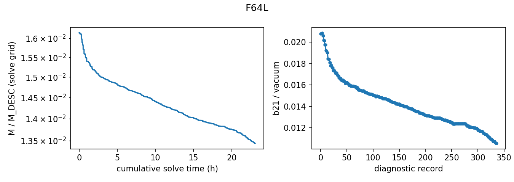

# Long-run report

Generated 2026-11-17 15:38 on Stellar AI (B200) from the F64L chain (in progress).

## F64L

| segment | phase | stage | alpha | steps | accepted | rejected | M/eps first | M/eps last | solve_h | M/M_desc | b/vac | band p16/DESC | errors |
|---|---|---|---|---|---|---|---|---|---|---|---|---|---|
| seg01 | floor | sweep ended | 0.001 | 1125 | 1104 | 21 | 16.1432 | 13.962 | 15.709 | 0.013962 | 0.0129137 | 0.136727 |  |
| seg02 | floor | sweep ended | 0.001 | 11 | 11 | 0 | 13.962 | 13.9613 | 0.122 | 0.0139613 | 0.012916 | 0.136673 |  |
| seg03 | floor | sweep ended | 0.001 | 154 | 149 | 5 | 13.9613 | 13.8226 | 2.733 | 0.0138226 | 0.0123805 | 0.128462 |  |
| seg04 | floor | sweep ended | 0.001 | 14 | 11 | 3 | 13.8226 | 13.8226 | 0.07 | 0.0138226 | 0.0123806 | 0.128439 |  |
| seg05 | floor | sweep ended | 0.001 | 13 | 11 | 2 | 13.8226 | 13.8226 | 0.084 | 0.0138226 | 0.0123807 | 0.128388 |  |
| seg06 | floor | sweep ended | 0.001 | 11 | 11 | 0 | 13.8226 | 13.8226 | 0.061 | 0.0138226 | 0.0123805 | 0.128355 |  |

Accepted steps: 1603 over 23.1 h of solve time; M/M_DESC 0.01614 -> 0.01344 (solve grid).

Diagnostics (337 records): b/vac 0.0208 -> 0.0106 (phase -90.0 deg); band p16/DESC 0.1773 -> 0.1003; outside mean/DESC 0.0132 -> 0.0123; |J-J_fit|/rms 1.2686e-02 -> 6.0609e-02.

